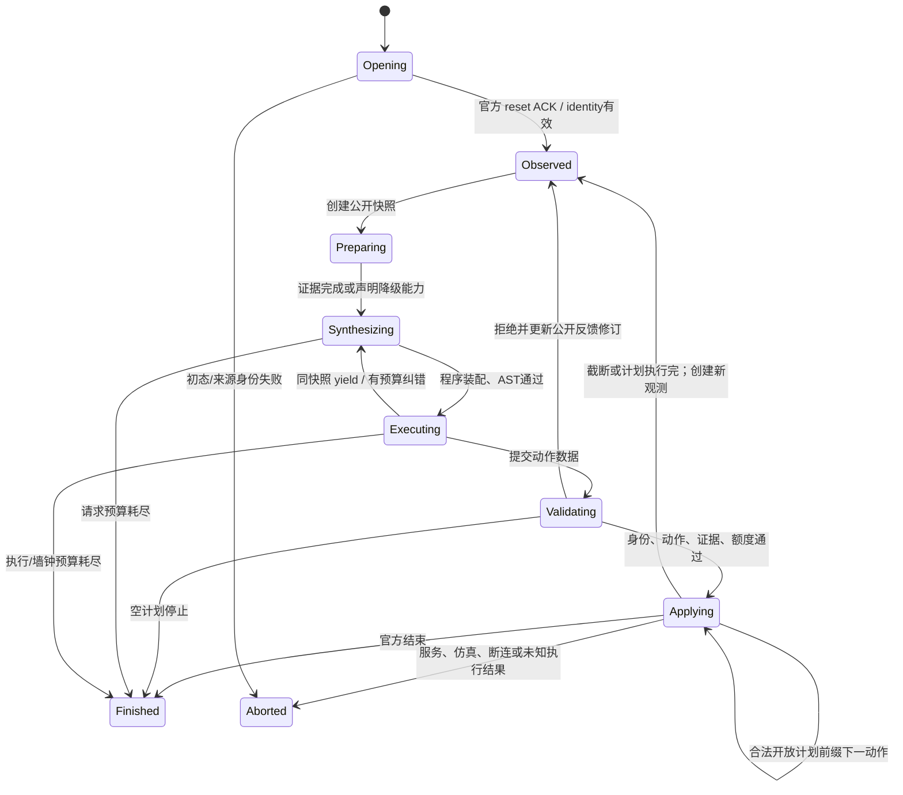

# harness3D 接入 EmbodiedBench：文件级实施计划

日期：2026-11-05。依据：[架构准备报告](ARCHITECTURE_PREPARATION.md)及 [交接要求](NEXT_AGENT_ARCHITECTURE_PREPARATION_PROMPT.md)。**本文保留原拟实施设计作来源参考；用户随后已批准P0–P4离线实施，并指定更改集中在本目录。实际状态见 [IMPLEMENTATION_STATUS.md](IMPLEMENTATION_STATUS.md)，上下文预算与固定选择见 [IMPLEMENTATION_CONTEXT_PLAN.md](IMPLEMENTATION_CONTEXT_PLAN.md)。本页原STOP、worktree优先、共享src改动和official_prefix方案已被覆盖：实际采用task-local适配、共享src只读、三个臂统一single_action。真实请求/仿真/部署尚未启动。**

## 1. 实施目标与固定边界

目标链为：合法官方观测 → 带身份的局部感知证据与冻结完整 Skill → coding agent 生成 Python → 独立受限执行与工具校验 → 动作提交 → 可信宿主逐动作执行官方环境 → 新观测/反馈。

采用“具身宿主 FSM + 不可变决策快照 + 共享 segment primitives”。主源码绑定 `src/skill3d/`，既有 `bare_run/household_run`、官方快照、九题基线和全局 v11 snapshot 保持原身份。初版三个环境、当前单张原图，不启动跨帧世界重建；不做演化、修订者、配对发布门或预算外补答。

本计划的阶段顺序是：授权实施后做来源隔离与离线合同 → 新 profile/segment → 宿主及三个 adapter → 感知/冻结方法/审计 → 离线验收 → 单独授权部署和三环境 smoke → 再冻结配对 pilot。

## 2. 来源隔离与恢复

### 2.1 推荐工作空间

优先在已核对 HEAD `1c4fb72479967266107ae3015694f5bcb506c8fe` 建隔离 worktree，例如同父目录的 `wjhICLR-embodied-architecture` 和新本地分支。这是实施阶段动作，本次未创建。

worktree 不包含未跟踪的 `embodiedRunner/`，必须先对现有任务目录做**显式文件清单和 SHA-256 绑定**。只复制经核对的 runner/bridge/协议/既有测试/文档及必要官方 source manifest；把大型只读 upstream、数据和旧 runs 通过配置绝对路径绑定原位置，host path checker 单独允许这些根。不得整目录复制 `checks/`、socket、runs、venv、凭据、`server.md` 或其他实验。现有 230 源文件及基线 hash 为起点，清单记录原目录、HEAD、每个纳入文件身份和共享只读根。

若 HEAD 上的共享源文件与已核对工作区 hash 不同，先停止合并该文件：明确依赖的既有改动，单独纳入经过确认的补丁及 hash；不能无声把其他任务的 dirty 源码带入实验。隔离入口必须验证 import 实际来自新 worktree，不能因 PYTHONPATH/动态加载继续读原主项目代码。

备选是在当前目录原位、仅显式路径修改并保存前置 hash；这会增加与其他 agent 的共享修改风险，仅在隔离方案不适用时使用。不能 reset/clean/restore 全树、自动 staging、commit、同步服务器或改变 Git 配置。

### 2.2 恢复与旧实验保护

新源码、测试、runs、预算、感知缓存和审计均在独立位置。恢复时停止本次拥有的进程，切回旧**入口/配置**，保留新失败目录和 receipt；不通过删除文件或改旧 run 来“回滚”。共享模块若影响 QA，先禁用新 opt-in profile 调用，不在正在运行的冻结实验源码上热切换。

工作完成后检查原主目录的 `source_sha256`、九题基线文件、active pointer 和已知 dirty diff 身份；任一非本任务变化归属不明时不能覆盖或自动修复。

## 3. 数据合同（全部待实现）

建议统一具身合同版本 `embodied-decision/1`，worker 协议使用 `embodiedrunner-navigation/2` / `embodiedrunner-household/2`。方法和执行合同独立版本；不得冒用现有 QA schema。

### 3.1 `EmbodiedEpisode`：宿主所有

| 字段 | 约束及用途 |
|---|---|
| `run_id`, `episode_id` | 本次尝试唯一 identity；与官方任务 ID 区分 |
| `environment` | 只允许 `eb_navigation` / `eb_alfred` / `eb_habitat` |
| `subset`, `task_index`, `official_task_id` | 公开任务清单身份，Habitat 绑定实际 episode ID |
| `official_revision`, `task_source_sha256` | frozen 官方源码及选择清单 |
| `instruction`, `input_sha256` | 允许给模型的原始任务指令及身份，不包含答案或轨迹 |
| `protocol_sha256`, `model_config_sha256`, `budget_sha256` | 固定三臂条件 |
| `method_ref`, `method_sha256`, `method_manifest_sha256` | 开题选择后整题不可变，B01/Direct 为空 |
| `session_id`, `mutation_revision`, `environment_step` | worker 写状态；每次成功 mutation ACK 后核对 |
| `status`, `terminal_reason`, `task_success`, `task_progress` | 仅宿主/评分/审计侧；官方决定 success |

训练/开发/验证/最终测试的 `split_role` 在清单和回执中固定，不依赖文件夹名称猜测。模型公开 context 不含 split 答案、成功/进度或底层 scorer。

### 3.2 `PublicObservation` 与 `DecisionSnapshot`

| 字段 | 校验 |
|---|---|
| `episode_id`, `official_task_id`, `environment`, `subset` | 必须匹配 active episode，不接受其他题 packet |
| `environment_step` | 真实 `env.step` 计数；invalid mutation 不递增此字段 |
| `observation_revision` | 宿主单调递增；图像、动作表、官方反馈或公开记忆变化都创建新修订，不能等同 step |
| `mutation_revision` | worker 单调递增；覆盖 step 和 invalid 状态修改 |
| `rgb_sha256`, `rgb_size`, `pixel_sha256`, `view_id` | 原 PNG 字节和解码像素 identity；默认 500×500 当前一图 |
| `action_table` | 官方 ID → 官方动作描述的不可变数组；拒绝 bool、float、负/越界 ID |
| `action_table_sha256` | canonical JSON identity，每题 reset 及每个 ACK 检查 |
| `public_feedback`, `feedback_sha256` | 仅原官方反馈组织允许的文字；保留 last-action-success 信息，不给评分字段 |
| `public_memory`, `memory_sha256` | 有界、带来源的允许记忆；不是裸环境状态 |
| `decision_id`, `snapshot_sha256` | 绑定上述公开字段、方法、预算和输入策略 |
| `evidence_revision`, `evidence_manifest_sha256`, `capabilities` | 本次局部证据和工具权限；证据扩充 create-once 新版本 |

宿主/worker 的 raw packet 与 `PublicObservation` 采用不同类型。decode 用字段白名单构造，不能把 `packet.__dict__`、`info`、`reward`、`done`、success、物体真实坐标、深度传给模型或工具。允许官方文字反馈中的任务线索；不额外解包 GT metadata。

### 3.3 `ActionPayload` 与 `SubmitActions`

建议唯一动作提交接口如下；它**尚未实现**：

```text
SubmitActions(ActionPayload(
    decision_id,
    observation_revision,
    snapshot_sha256,
    action_table_sha256,
    actions = [integer_action_id, ...],
    evidence_refs = [result_id, ...],
    memory_update = bounded_public_record
))
```

episode/session/mutation 身份由不可修改的执行 envelope 补齐，宿主必须同时验证 payload 与 envelope；不信任模型填写的 identity。`actions=[]` 表示 empty-plan stop。未知字段、重复键、非有限值、错误类型、越界动作均拒绝；合法序列超过剩余动作数时按 `official_prefix` 截断并记录。单个 NDJSON packet 保留 12,000,000 字节上限，单次提交最多32个证据引用，动作列表不能超过该环境整题动作cap。

三臂均保留 Qwen `response_format={"type":"json_object"}`。Direct 返回原官方 `executable_plan` 结构；B01/B11 返回唯一字段 `{"program_source":"Python source"}`。可信宿主严格解码后，将字符串传给已有 `assemble_program_ex(..., intended_answer_slot="SubmitActions")`；不能直接把JSON响应交给Python提取器，也不能执行其他响应字段。格式恢复只在统一预算内完成，B01/B11同规则。

`evidence_refs` 可以为空（仅 RGB 计划），但若程序读取并使用几何，kernel 必须登记**实际读到的完整依赖集合**。动作 validator 检查显式引用与运行账本，不能由模型漏填引用绕开陈旧/不可信结果。拒绝无效、其他题、其他决策、旧观测或未获授权的数值结果。

动作 profile 允许一个执行段终结为 `SubmitActions` 或 `YieldObservations`。提交成功后控制立即退出，后续代码不能再执行工具或第二次提交。禁止 `ReturnAnswer/AnswerPayload`、用户直接 `reset/step`、shell、SSH、HTTP、文件及原生指针 I/O。`YieldObservations` 只请求同决策证据，不推进环境。普通请求/修复轮完整 Skill 交付，不设置省略方法的动作 finalization。

`memory_update` 只允许有界子目标文字和附来源/置信状态的视觉或官方反馈摘要；候选上限为16条、总计4000字符、子目标1000字符。宿主重新验证长度、来源 scope 和无禁用字段后采纳。不接受模型自造的“官方成功”、确定 GT pose 或无依据 inventory。程序修复反馈最多4000字符，不拼接原始stdout或服务异常；`ReadObservation`每页沿用4000字符/32项上限并另受读取次数约束。

### 3.4 `EvidenceManifest` 与 result scope

每个局部证据包含：

- 原图/像素、task/decision/observation/evidence revision、父 manifest hash。
- 后端型号、checkpoint/config hash、输入/输出 hash、数值单位、有效像素 mask、内参来源。
- candidate ID、类别词来源、检测 box；mask hash 与图像对齐 identity。
- 类别核验与独立 mask/几何核验分别保存状态、审查模型/版本/hash、阈值、拒绝原因。
- depth/points hash、shape/dtype、原像素坐标规范、`relative_per_view` 单位；无尺度时 `metric_world=false`。
- capabilities 例如 `current_rgb`, `candidate_category`, `relative_depth`, `relative_points`, `validated_candidate_surface`；默认不声明跨 view/world geometry。
- 每次服务调用的预算 permit、计数、时间、usage（如有）、脱敏模型身份；不能保存 credential、URL query 或完整异常。

result ID 的 lookup key 必须含 episode/decision/observation/evidence revision。扩充证据时原结果保持可追溯，只允许在输入 hash 未变且依赖未撤销的同决策范围继续使用。任何真实环境动作后，原“current”结果全部撤销使用资格；不能仅比较 PNG hash 相同就恢复，因为反馈/物体状态可能已变化。

默认历史图像策略为 `current_only`，不给模型历史 RGB，不用历史图像做 reconstruction。允许保留官方文字反馈和带来源的有界记忆。以后若引入实际历史帧，必须新协议、新清单、新对比；只接纳已真实获得的帧，逐帧标时序和旧状态，禁止未来帧/模拟器 GT。

## 4. 状态机、计划执行与故障语义

### 4.1 宿主 FSM



每个转移写 append-only receipt。服务故障不进入模型纠错；格式、程序、工具参数或计划错误可以在原总预算内走纠错。`Preparing` 的后端运行故障终止；预期的“无可用几何”只在已冻结的 RGB 降级策略下继续，B01/B11 同规则，不能隐式重试后端。

### 4.2 多动作边界

建议初版 `official_prefix`：

1. `SubmitActions` 只生成开放式 action ID 序列，不是能随环境继续运行的 controller。
2. 宿主在计划接受时校验当前 revision、表 hash、全部 ID 和剩余动作额度。超过剩余 cap 的合法序列只执行冻结协议允许的前缀，记 `truncated_by_budget`。
3. 每个 action 前再校验 worker session/revision/step/表 hash；记录 `first_in_plan`，Navigation 沿用原语义。
4. 逐动作获得并保存真实 ACK/当前 RGB/反馈。第一动作开始后 sandbox 已销毁；不得用其旧局部变量读取后续画面。
5. 对于明确只依赖已接受开放计划的后续 action，可以继续；失败、done、动作表变化、预算 cap 立即截断。如果后续动作声明依赖当前几何条件，宿主必须截断为新决策，不能重新校验旧 result 后假装它是当前几何。
6. 计划结束或截断后创建新 `observation_revision` 和 decision；重新感知并生成程序。

动作表变化要先结束当前批次，更新新观测，旧 action IDs 不能迁移解释。初版不默认将所有批次限制成单动作，因为那会改变既有官方计划执行条件；若 later 选择单动作，Direct/B01/B11 必须一起使用新规则及新目录。

### 4.3 跨动作状态处理

| 状态 | 同快照的合成/执行段之间 | 真实 action 后 |
|---|---|---|
| 用户 Python 变量/对象 | 每次执行清空，显式有界反馈重建 | 子进程结束，不能保留 |
| 工具/授权/读取账本 | 只增不减，逐段视图 | 归档保留，旧 current 使用权限撤销 |
| candidate/mask/depth/points | hash一致、依赖有效时可读 | 全部按旧观测失效；当前帧重新准备 |
| 对象绑定 | 同观测内有来源的局部 candidate ID | 不自动等同新对象；跟踪需新证据和单独能力 |
| 持有/开关/容器状态 | 允许反馈/视觉有来源摘要 | 已确认反馈更新；无新确认则保留带时间的不确定历史 |
| 工具权限 | 每段由 manifest 重算 | 重新构造，旧权限不能累积 |
| 冻结 Skill | 完整交付同一 hash | 整题仍同一 hash；能力分支可变化 |
| 官方 step/invalid/success | 只由宿主 ACK 更新 | 独立计数，官方评分不进入 sandbox |

### 4.4 终结与错误类别

| 事件 | 环境 mutation / 模型续行 | 记录与分母 |
|---|---|---|
| 官方 done/success | 停止；只信官方字段 | `official_done`，按真实 `task_success` |
| 空计划 | 不 step；停止，不自称成功 | `empty_plan_stop`，保存当前官方结果 |
| 模型格式/动作提交错误 | 家务按冻结映射调用一次官方 `invalid`，不 step；有预算可再决策 | `model_output_format_error` / `invalid_action_plan`，单列 parser/program error |
| AST/程序/引用/工具错误 | 不执行 action；有预算可纠错 | `program_error` / `evidence_rejected`，不得冒充官方 invalid step |
| 非法 action ID 到 worker | mutation 前拒绝 | host实现缺陷或契约拒绝；不得放行 env.step |
| official action 失败 | 已执行的 step照计；截断计划，取新反馈 | official invalid/action failure计数与program错误分开 |
| 请求/工具/执行/墙钟 cap | 不新增请求或动作；停止 | `budget_exhausted`，注明维度 |
| 模型/感知服务故障 | 立即停止，无自动重发 | `operational_failure`，使用已消耗 permit |
| 仿真异常、断连、ACK未知 | 立即停止；不重置重放当前题 | `simulator_failure` / `action_outcome_unknown` |
| 本地合同/身份错误 | fail closed | `contract_failure`，保留完整尝试历史 |

主要分母用预先选定的任务集合。运行中断时保留未执行项的 `not_run_due_to_abort`，同时报告计划分母、实际启动/完成数；不能只报完成成功率。失败、运行故障及缺失结果在保守成功率中不算成功，另报 operational coverage；不能把系统中断解释为模型推理失败。

## 5. V2 通信与幂等 mutation

现有 `bridge.py::request` 只检查 NDJSON 序号/协议，报文 cap 12,000,000 字节；家务 `invalid` 也会改变环境计数。V2 必须在 step/invalid/open 等 mutation 的 worker 侧先验检查。

建议请求 envelope：

```text
transport_sequence, protocol_version, session_id, command_id(UUID),
command_digest, op, episode_id, expected_mutation_revision,
expected_environment_step, expected_action_table_sha256, bounded_parameters
```

worker 建 session，宿主首次握手取得 token；`open` 也有去重身份，不能重复 reset。worker 先按 `command_id` 查缓存：相同 digest 返回原响应、不再次 mutation；不同 digest 拒绝。再检查 session/episode/revision/step/表 hash 和参数，检查通过后才执行；完成后增加 mutation revision 并缓存包含命令 digest、before/after、step、表和 packet hash 的 ACK。

`invalid` 增加 mutation revision/invalid count，environment step不变；宿主据此刷新 feedback/observation revision。非法输入在校验阶段不修改上述 counters；家务原宽松 `int(action)` 路径由严格 JSON 类型检查替代。

对同一 worker 存活期间重复命令做到去重。执行已发生但 ACK丢失、worker崩溃、缓存未持久化或进程重建时，**不具备跨崩溃 exactly-once 保证**。初版遇到未知执行结果直接停止，无自动重连重发；以后若恢复只能使用独立只读 query 查原 command 状态，不能默认再 step。不得把 transport_sequence 当业务去重 ID。

V1保留独立入口，不在旧运行目录使用V2。三臂新实验必须共享V2宿主调度、合法前缀规则及同一官方环境版本；重跑Direct新协议作为新 baseline，不能将旧九题结果混入新配对。

## 6. 独立执行进程与共享复用边界

### 6.1 拟新增共享 primitives

`sandbox/control_profile.py::ControlProfile` 定义可信 host 选择的控制名、提交槽、context字段和静态检查策略。默认 `qa_v11` 维持原保留名、Answer/Yield、SceneHandle 和所有默认序列化身份；新增 `embodied_actions_v1` 注入动作槽和只读 public decision view。生成程序不能选择 profile 或传 host callback。

`sandbox/segment.py::execute_segment` 输入装配程序、冻结 public context/frames、局部 registry、profile、预算/ledger view，输出有类型的 submission/yield/error 和逐段账本。抽取 `_execute_program` 的 kernel调用/逐段trace收集，不搬 QA 评分、M5重建、恢复问答策略或 3,700 行 runner。先建立 QA 行为对照，确认后原 `_execute_program` 仅委托公共执行部分，外围 receipts和既有字段语义保持一致。

`skills/frozen_method.py::FrozenMethod` 是全文内容/metadata/source identity 的明确类型；复用 `normalize_skill_markdown/parse_skill_markdown`。`delivery.render_skill_entry` 增加该类型的明确分支，unknown类型拒绝；QA既有 `SkillSpecV11` 渲染、length、hash和delivery receipt保持原输出。

`synthesis/execution_contract.py` 对新 profile 提供独立具身合同表示，不把动作字段加进QA默认 `ExecutionContract.to_dict()`。否则会改变正在使用的QA合同hash。新action prompt在任务目录构造，不替换 `program_synth_v11_14_en`。

### 6.2 进程边界

`embodiedRunner/sandbox_process.py` 启动无凭据执行子进程；`sandbox_worker.py` 仅加载已经 hash验证的局部证据和公共执行 primitives。宿主Qwen/SSH/感知客户端不pickle传入；只序列化白名单 public context、像素和数值证据。子进程不导入 `run.py/ssh_session.py/remote_runtime.py`，不持有worker环境对象。

执行要求：

- 清除所有服务key/endpoint和代理环境，显式最小环境、独立临时目录、只读证据根、关闭非必要fd。
- AST/import/属性/数值模块包装继续启用；禁止宿主文件读取、memmap/fromfile/save、ctypes/native pointer、可变共享NumPy模块及frames写入。仅清空环境变量不是文件/网络隔离。
- Mac先用已存在的sandbox-exec验证deny网络、deny非许可文件、子进程创建等策略；Linux备选使用bwrap只读绑定解释器/必要库/本次证据、独立tmp与网络namespace。工具存在不等于策略可用，需实际假输入验证。
- 每段/整题有CPU/墙钟/内存/输出cap；超时终止本段owned进程组，并将state定为执行失败。Mac内存限制能否可靠执行需验证，不能仅设置RLIMIT_AS就称硬上限。
- sandbox输出只能是受限typed结果/receipt，raw stdout/traceback/source不直接写报告；给模型的修复信息经过有界白名单，只包含错误类别、行号、工具拒绝原因。

若Mac隔离策略不能满足要求，改为**独立Linux执行服务**，使用主架构兼容的新runtime，不能复用家务Python3.9并安装主依赖；这涉及新增部署，需要另行授权。初版不能降级到持key的Mac主进程执行，也不能把bwrap安装/namespace权限猜成已验证。

## 7. 感知、几何与初始 Skill

### 7.1 初版感知路线

`evidence.py::prepare_decision_evidence` 使用允许当前RGB的Mapping，复用 `SmallImagePrecomputer.process` 及DINO/SAM2/MoGe2适配器。类别词从公开指令/动作描述和共有类别解析合同提取，默认确定性解析；B01/B11的准备器不能读取方法正文来改变类别、阈值或后端配置。若需要LLM类别解析，只允许输出有界类别列表，计入总Qwen请求，不能问“应该执行什么动作”，两程序臂使用同一规则。

首版工具面：

| 工具 | 准入 |
|---|---|
| `view_candidates` | 当前观测的检测/类别信息，明确不是可信对象表面 |
| `view_depth_summary` | hash/shape/单位检查通过的当前相对深度 |
| `point_depth` | 原像素5×5邻域有效深度中位数，至少3有效值，relative_per_view |
| `pair_point_distance` | 同一view、数值points有效，保持相对单位 |
| `candidate_depth_summary` | 默认禁用；现有small-image实现拒绝，需独立mask表面合同后另开版本 |
| `ReadObservation` | 已获准本决策结果的有界字段，不查询raw packet/scorer |

不能把depth显示颜色当数值；如后来给模型深度图或标注图，登记新增输入图/预处理hash，B01/B11相同，且Direct系统比较解释其输入差异。初版不新增可视化图，只发一张原始RGB和有界工具文本。

MoGe2内参若为预测值，明确来源，不作为模拟器GT或可信世界尺度。旋转90°、低重叠、高层find/nav、对象移动不满足跨view刚体重建假设；初版不使用M5全局绑定/32帧FrameSet，不声称完整3D重建。

### 7.2 冻结方法合同

任务目录拟新增 `methods/manifest.json`、`methods/{navigation,alfred,habitat}/SKILL.md`。metadata包括方法ID/版本、适用environment/control profile、所需最低能力、可选能力分支、合法工具集、完整正文hash。

开题先按环境及能力检查方法适用性，再freeze该题method ref/manifest/hash，后续每个真实合成和纠错请求完整交付同一正文。capability下降使用已冻结全文中的RGB分支，不换正文；正文超过服务上下文预算时preflight拒绝，禁止截断成摘要。

方法源库独立于 `skill_library/snapshots`。不得改 `routing.task_classifier.TASK_TYPES`、VSI `v11_library`槽位或全局active pointer。以后可定义具身learning/validation/promotion接口，但初版无自动修订/发布、reviser/gate请求为0；九题开发结果不能转成独立测试证据。

## 8. 统一预算与实验矩阵

### 8.1 候选冻结预算

以下是**待开发smoke校准、再冻结的pilot建议**，不是已经测试的容量或效果。官方step/invalid cap维持既有值。所有服务调用从同一个episode/run permit源预留，错误也消耗已发出额度。

| 维度 | Navigation / 题 | ALFRED、Habitat / 题 | 规则 |
|---|---:|---:|---|
| official env.step | 20 | 30 | 不能以纠错扩展 |
| official invalid | 沿官方终结语义 | 10 | parser/program错误另外计数 |
| 所有Qwen真实请求合计 | 20 | 40 | solver、修复、类别解析、终结若存在均计入，不另给角色预算 |
| 每个decision合成请求 | ≤3 | ≤3 | 首次+至多2纠错；同时受整题cap |
| 单次Qwen completion | ≤4096 tokens | ≤4096 tokens | seed137、temp0、thinking=false；stream恢复无自动续请求 |
| 全部模型请求合计，含类别/审查模型 | ≤40 | ≤70 | Qwen子cap仍有效；审查模型全部记录usage |
| 类别核验模型 | ≤20 | ≤30 | 每次最多4当前候选；这是上限，不默认每候选发一请求 |
| DINO / SAM batch / MoGe2 | 各≤20 | 各≤30 | 每个获得的当前图最多各一次；同hash reuse也记录来源，不跨题串缓存 |
| 数值工具调用 | ≤12/decision，≤240/题 | ≤12/decision，≤360/题 | 含拒绝调用；ReadObservation另≤3/执行段，≤6/decision |
| sandbox段数 | ≤3/decision，≤60/题 | ≤3/decision，≤90/题 | yield、程序失败也占段数 |
| 单段墙钟 / 输出 | 10s / 64KiB | 10s / 64KiB | 独立进程策略离线实测后固定 |
| sandbox内存候选cap | 1GiB | 1GiB | 需证明实际限制可执行；不含可信宿主服务内存 |
| 每题总墙钟 | 600s | 900s | 含reset、感知、模型、程序、step等待 |
| 单次模型 / 感知 / step等待 | 120s / 60s / 120s | 相同 | 不自动retry；reset可另固定180s且仍计总墙钟 |
| 观测原图 | 当前1张500×500 | 同左 | 不继承32帧/额外视觉补答 |

所有臂总预算相同；Direct工具服务消耗为0，并不将未用工具预算兑换成更多模型请求。模型审查cap与Qwen cap均属于全部模型cap的子项。若实际backend一次batch需多次内部模型请求，必须逐一计数，不把整个adapter调用当作一个请求。

tokens完整统计prompt/completion/total并注明缺失usage。初版建议Qwen题级观察停止阈值Navigation 150k、家务250k total tokens；其他模型usage另汇总。这是收到usage后阻止后续请求的**软阈值**，最终一次可能越过；现有RequestGovernor只硬限请求数，不能声称硬限总tokens。若需要硬token预算，必须有实际provider/tokenizer预估及发出前worst-case reservation验证后另冻结。

run预算由预选清单N派生：Navigation Qwen≤20N，家务≤40N，全部模型/工具/动作cap按表累加；每arm独立budget目录，禁止复用BLINK/GPTexp/FullQA预算。初版 `max_inflight=1`，不与共享GPU容量混算。

现有 RequestGovernor 的 category 仅允许 `solver/reviser/diagnosis/gate`。初版规划、程序修复和有界类别解析均通过 `solver` 总额度，任务侧另记脱敏 stage 枚举；不向旧governor随意增加未实现的category。`reviser/gate` 为0。Intern等非Qwen审查由题级全部模型permit单独预留，仍计总模型cap；不得持其他budget目录的client绕过此入口。

### 8.2 三臂矩阵

| 臂 | 规划输出/执行 | 方法全文 | 输入/工具 |
|---|---|---|---|
| Direct Qwen | 原官方prompt/示例、JSON动作计划、同V2宿主 | 无自有Skill | 当前原始RGB和官方反馈；prepared、候选、工具0 |
| B01 | coding agent生成Python，经同profile/沙箱/validator提交动作 | 无完整方法正文 | 公共执行合同、官方相同示例/动作信息；同感知与质量门 |
| B11 | 同B01程序生成/执行 | 整题冻结完整具身Skill，每普通轮交付 | 与B01相同输入构造、工具、质量门、预算和纠错 |

Direct→B11比较为完整系统效果；B01→B11才衡量方法全文变量。B01不能偷偷移除工具说明/合法动作合同或拥有另一条fallback，B11不能得到额外诊断者答案。两臂可能选择不同工具和轨迹，这是方法导致的行为结果；工具配置、准入、计数规则和输入生成政策保持相同。

固定官方revision、task清单/实际episode、reset种子、action_table初态、原图初态hash、模型请求参数、分辨率、shots、反馈历史政策、终止/格式策略、批执行政策和cap。交互后的轨迹/图像可以不同，不要求逐帧相同；若初态hash因渲染非确定性不一致，先做A/A并冻结允许差异的审查规则，不能静默放过。

B01/B11代码输出使用同一Python封装/解析规则；Direct保留JSON-object及官方parser适配。不同输出格式属于系统差异，不能解释为Skill收益。新增格式修复策略必须三臂有明确、预算内对等规则，并使用新协议。

### 8.3 数据隔离、顺序和统计

九题永远标为 `development`。后续独立validation建议每环境按预先清单选6题，避开这九题并先验证真实资产/轨迹；最终test再从不重叠任务选定，development可用于修改方法、validation用于选冻结版本、final_test只用于最终结果。选择不能看任务答案/试跑成功后换题。

先三环境各一题开发smoke；通过后开发九题三臂合同验收；随后独立validation配对pilot，再决定是否正式全量。A/A用冻结同臂重复独立初态运行、独立预算和run目录，检查同参数模型/渲染噪声；不自动对失败题重试以提高分数。

主要指标为官方task_success，报告固定分母和逐题paired差；task_progress、官方invalid、格式/程序/工具错误率、总requests/tokens、perception calls、sandbox和env.step时间、总墙钟为辅助。配对样本小需逐题表和不确定性；不能从3题成功率承诺新方法收益。所有attempt和operational failure保留，不能从skill buffer或结果表删除。

## 9. 文件与函数级变更清单

下表是实施阶段精确目标。新增文件标“新”；既有函数是已核对定位。项目会按隔离来源清单绑定，不混用源码副本。

### 9.1 共享架构：必要、opt-in

| 文件 | 拟函数/修改 | 依赖与验收 |
|---|---|---|
| `src/skill3d/skills/frozen_method.py`（新） | `FrozenMethod`, `load_frozen_method`, `validate_method_identity` | 复用schemas/skill纯解析；拒绝路径越界/正文hash错 |
| `src/skill3d/skills/delivery.py` | `render_skill_entry`, `skill_version_key`, `plan_delivery`明确支持新类型 | QA同输入渲染/hash不变；新全文交付/失败receipt正确 |
| `src/skill3d/sandbox/control_profile.py`（新） | `ControlProfile`, `QA_V11_PROFILE`, `EMBODIED_ACTIONS_PROFILE` | sealed可信配置；generated code无选择权 |
| `src/skill3d/sandbox/ast_guard.py` | `ast_guard`, `_WhiteListVisitor`接受profile；按profile保留名/context字段检查 | 默认QA保留集不变；动作profile禁ReturnAnswer、host I/O、覆盖SubmitActions |
| `src/skill3d/sandbox/action_check.py` | `check_action`按profile检查terminal；现有QA branch不变 | 静态检查加runtime单提交；非法双终结拒绝 |
| `src/skill3d/sandbox/kernel.py` | `RestrictedNamespaceKernel.__init__`, `reset_user_namespace`, `run_cell`增加profile/public context/action slot | QA namespace/ledger/timeout恢复保持；动作模式只输出typed数据 |
| `src/skill3d/sandbox/segment.py`（新） | `execute_segment`, `SegmentExecutionResult`, `collect_segment_trace` | 提取受信kernel执行，不依赖VSIBenchEpisode/scorer或全局REGISTRY |
| `src/skill3d/online/runner.py` | `_execute_program`仅委托已验证segment公共部分 | 当前3121–3173行范围；保留QA外围receipt、reset、逐段视图及deterministic replay |
| `src/skill3d/synthesis/execution_contract.py` | `profile_execution_contract`独立表示及审查 | QA `to_dict/sha256/render`默认输出不变；不改CONTRACT_VERSION冒充QA |
| `src/skill3d/online/observation_reader.py` | `read_observation`增加可选scope验证和profile字段白名单 | QA默认reader合同/receipt不变；拒绝跨decision/历史current结果 |

`program_assembler.py`直接复用已有slot参数，不需为动作复制parser。`schemas/episode.py/skill.py`、VSI `routing/task_classifier.py`、`tools/task_policy.py`、全局REGISTRY、`v11_library.py`和active snapshot**不需要为本次具身接入改语义**。如实现发现必须修改这些默认路径，应先说明具体合同原因并扩充回归，不能通过扩大VSI类型集合绕过设计。

### 9.2 任务目录：共同宿主

| 文件 | 拟函数/职责 | 顺序/通过条件 |
|---|---|---|
| `embodiedRunner/action_contract.py`（新） | 上述dataclass/schema；`validate_action_payload`, `public_observation`, `canonical_action_table` | 先做strict types/白名单/identity假输入 |
| `embodiedRunner/state.py`（新） | `EpisodeState`, `advance_observation`, `invalidate_after_mutation`, `finish_episode` | mutation、step、obs/evidence revisions独立；失败不丢历史 |
| `embodiedRunner/evidence.py`（新） | `prepare_decision_evidence`, `validate_manifest`, `EvidenceStore`, `invalidate_current` | 用白名单Mapping复用precompute；create-once与hash校验 |
| `embodiedRunner/action_tools.py`（新） | `build_action_registry`, `authorize_current_result`, per-view工具wrapper | instance registry，候选surface默认拒绝，旧结果不可恢复 |
| `embodiedRunner/methods.py`（新） | `load_method_manifest`, `select_and_freeze_method`, `check_applicability` | 独立具身family、完整正文/hash，不读active VSI库 |
| `embodiedRunner/action_prompt.py`（新） | `build_action_messages`, `public_feedback_text`, `bounded_program_feedback` | 一原图、原示例信息、全文、公共合同；无score/raw packet |
| `embodiedRunner/action_solver.py`（新） | `solve_decision`, `synthesize_segment`, `validate_segment_submission` | governor包所有Qwen调用；最多3次/decision，无Answer fallback |
| `embodiedRunner/budget.py`（新） | `EpisodeBudget`, `reserve_request/tool/action`, `record_usage`, `stop_reason` | run RequestGovernor +题/stage子cap；permit-before-call，无raw text |
| `embodiedRunner/sandbox_process.py`（新） | `launch_segment`, `build_isolation_policy`, `terminate_owned_group` | credential-free env、fd、FS/network/resource真验证 |
| `embodiedRunner/sandbox_worker.py`（新） | `main`, `decode_execution_input`, `execute_and_encode` | 只导入segment/public证据，不导入credentials/SSH/client |
| `embodiedRunner/action_runner.py`（新） | `run_episode`, `run_decision`, `apply_plan_prefix`, `close_episode` | 唯一环境写路径；shared FSM、failure/done截断与新观测 |
| `embodiedRunner/action_run.py`（新） | 新CLI、来源/预算/任务选择preflight | check仅fake/static；run默认不开live，显式批准配置后使用 |
| `embodiedRunner/audit_action_run.py`（新） | `audit_identity`, `audit_transitions`, `audit_delivery`, `audit_budgets`, `audit_tool_scope` | 分母/requests/steps/invalid/hash全对，输出新audit不改旧目录 |
| `embodiedRunner/paired_action_eval.py`（新） | `build_pair_manifest`, `validate_initial_identity`, `summarize_paired` | task/初态/方法变量/预算清楚；不同轨迹允许 |
| `embodiedRunner/methods/manifest.json`及三个`SKILL.md`（新） | 三environment可执行方法正文 | 仅获准实施后创建；先contract审核/开发验证再freeze，不发布全局 |

### 9.3 任务目录：桥接和环境特有层

| 文件 | 拟变化 | 特有约束 |
|---|---|---|
| `embodiedRunner/mutation_protocol.py`（新） | V2 envelope、digest、`MutationGuard`, `ResponseCache` | open/step/invalid均校验；缓存同UUID，错digest拒绝 |
| `embodiedRunner/action_bridge.py`（新） | `ActionBridge.open/step/invalid/query/close`，有界NDJSON与strict decode | 复用transport思想而不替换V1入口；超时终止、no-resend |
| `embodiedRunner/protocol.py`、`household_protocol.py` | 原V1类型/函数复用只读，不扩raw fields | 新action合同独立文件，既有protocol字节不变 |
| `embodiedRunner/simulator_worker.py` | 新V2 dispatch/选择flag包住 `OfficialNavigation.open/step` | 不改官方源码和V1默认；表8项，20steps，first_in_plan |
| `embodiedRunner/household_worker.py` | 新V2 dispatch包住 `OfficialHousehold.open/step/invalid` | ALFRED动态表；Habitat episode/head_rgb；保留native_log独立fd |
| `embodiedRunner/adapters/navigation.py`（新） | `NavigationAdapter.public_observation/parse_direct/apply_step` | 原OfficialBarePlanner及官方3-shot复用，strict action IDs |
| `embodiedRunner/adapters/alfred.py`（新） | `AlfredAdapter.public_observation/parse_direct/apply_invalid` | 原10-shot/合法前缀、每题表更新、原软件渲染 |
| `embodiedRunner/adapters/habitat.py`（新） | `HabitatAdapter.validate_episode/public_observation` | 70动作、真实episode、只head_rgb |
| `embodiedRunner/remote_runtime.py` | 可选明确worker/profile入口，原默认路径保留 | 不安装依赖、不改既有服务，不向sandbox传auth |
| `embodiedRunner/action_protocol_pilot.json`（新） | 三臂共有候选预算/模型/输入/终结政策 | 开发smoke校准后另freeze，不能复写bare配置 |

worker调度变化只能在新版本目录部署；V1默认路径离线回归不变。`bare_run.py/household_run.py`及既有audit不改；新Direct adapter复用原planner，三臂共同使用新宿主。

## 10. 验证计划、命令与验收

以下命令为**实施后拟提供的接口**，本次未运行。可执行CLI定义应按此落实；测试名称是计划创建名称，不声称仓库已有。不要调用会读 `load_authorized_key()` 的旧check入口。

### 10.1 离线合同与状态测试

拟新增 `embodiedRunner/tests/`：

| 测试 | 有意义的用例 / 通过标准 |
|---|---|
| `test_action_contract.py` | bool/float ID、重复JSON key、越界/空计划、旧动作表、其他episode、score字段；所有禁止输入fail closed |
| `test_state_invalidation.py` | action后RGB相同但反馈变、invalid不加step、对象移动/持有更新、证据扩充；旧结果无current权限，hash不覆盖 |
| `test_mutation_protocol.py` | 相同command重复不二次step/invalid/reset；UUID不同digest/旧revision拒绝；ACK丢失后host停止不重发 |
| `test_action_sandbox.py` | SubmitActions后工具/第二提交不执行；Answer禁用；别名IO/native pointer/共享NumPy/frames修改拒绝；timeout恢复/ledger可追溯 |
| `test_process_isolation.py` | 假credential哨兵、禁止文件和socket、继承fd、子进程、无限循环/输出；实际OS策略拒绝，主进程存活 |
| `test_evidence_scope.py` | 跨view距离/米制claim、category≠surface、旧mask、不同像素/模型hash、缺深度降级；capabilities和工具拒绝一致 |
| `test_method_delivery.py` | B11每普通轮同全文hash，B01无全文；超长拒绝；请求失败不标delivered；QA渲染同输入保持 |
| `test_budget_accounting.py` | request前预留、parse/review全部计数、usage缺失、无自动retry、各cap同时生效 |
| `test_adapters.py` | nav8/ALFRED208→218→181/Habitat70；原shots/head_rgb/feedback/parse-prefix；禁止raw packet |
| `test_runner_fsm.py` | 多动作failure/done/table change截断；几何dependent后续重新决策；服务失败/未知动作结果不复跑 |
| `test_paired_identity.py` | 固定任务和初态、B01/B11除全文变量一致、Direct工具0、失败/未启动分母保留 |

新增共享 `tests/test_segment_profiles.py` 验证同一QA假输入在旧执行和抽取segment下的程序/提交、工具结果、授权/reader receipt、namespace reset、deterministic replay一致。新增测试用于新边界/状态故障，不为纯文档或机械wrapper另写镜像测试。

拟命令（在隔离worktree中）：

```bash
.venv/bin/python -B -m pytest -c /dev/null -q -p no:cacheprovider \
  embodiedRunner/tests tests/test_segment_profiles.py

.venv/bin/python -B embodiedRunner/action_run.py check \
  --offline --fake-inputs --output embodiedRunner/checks/action-architecture-offline
```

实现CLI应在导入阶段也不加载真实key/GT/模型backend；offline check显式清除敏感env/端点并禁止外部socket。额外跑现存官方bare四项和家务四项，以及共享修改实际涉及的AST/kernel/delivery/reader合同；测试列表在第一阶段根据真实路径锁定，不盲跑可能选取GT或调用服务的全套实验。

通过标准：上述合同全过；源hash/旧baseline/active pointer保持；无外部requests、感知、仿真launch；实际OS拒绝证明存在；所有QA默认序列化/合同身份未改变。OS策略不可用时标阻塞并停止live，允许继续纯合同开发。

### 10.2 单独授权的live smoke

部署先给出精确包清单/hash、owned目录、worker版本和GPU配置，再获部署/执行授权。复用已安装官方env，不install，不重启共享服务。ALFRED全量数据不足不影响前三题开发smoke，但独立选题必须先验证对应轨迹。

拟命令：

```bash
.venv/bin/python -B embodiedRunner/action_run.py smoke \
  --environments eb_navigation eb_alfred eb_habitat \
  --task-manifest embodiedRunner/checks/action-smoke-development.json \
  --protocol embodiedRunner/action_protocol_pilot.json \
  --live --output embodiedRunner/runs/action-smoke-new-protocol

.venv/bin/python -B embodiedRunner/audit_action_run.py \
  embodiedRunner/runs/action-smoke-new-protocol
```

每环境1题、仍是已用开发样本；明确模型/感知/step caps。启动前重新读allowed GPUs和任务owned进程，避免与BLINK/GPTexp/FullQA冲突。硬性通过是identity、完整全文交付、程序隔离、工具scope、action单写路径、计数/终结/图像/audit全部正确；真实task_success另报告，不要求全题成功才能承认接入合同完成，也不能把合同通过当科学收益。

### 10.3 新协议配对pilot

拟命令：

```bash
.venv/bin/python -B embodiedRunner/paired_action_eval.py run \
  --arms direct b01 b11 \
  --task-manifest embodiedRunner/checks/action-validation-frozen.json \
  --protocol embodiedRunner/action_protocol_pilot.json \
  --live --output embodiedRunner/runs/action-validation-paired
```

启动前冻结独立validation来源、轨迹/资产、模型、方法、协议、预算和初态规则；每arm独立run/budget目录，前置摘要与审计脚本可review。不把旧九题和新轨迹混成同一配对。pilot合同通过后才讨论扩大范围和最终test；方法提升没有预设保证。

## 11. 分阶段完成标准及停止条件

| 阶段 | 顺序与产物 | 完成 / 恢复 |
|---|---|---|
| P0 来源隔离 | 创建受控worktree、显式纳入untracked源码、source/import/read-only根清单 | 旧workspace身份不变；错误来源绑定先修正，不继续live |
| P1 共享segment/profile | FrozenMethod、AST/kernel控制profile、segment、QA对照 | QA默认合同及receipt一致；有回归先停新profile，不改QA语义适配 |
| P2 具身合同/FSM/V2 | payload、revisions、mutation去重、三个fake adapters、budget | 重复/过期/未知ACK不会重复动作；只有host写env |
| P3 隔离/证据/方法 | OS策略真实假输入测试；per-view证据工具；三个独立完整Skill | credential/files/network/resource边界可证明；surface未验证保持拒绝 |
| P4 离线综合 | fake端到端、public输入/预算/交付/分母审计、既有基线回归 | 0 live调用，新产物目录，所有关键合同通过 |
| P5 部署及开发smoke | 单独批准后按包hash部署，三个环境逐个1题 | 完整trace/audit、保留失败，无自动重试；故障只停owned任务 |
| P6 配对验证 | 开发合同通过后freeze独立validation，Direct/B01/B11 +必要A/A | 固定分母/方法变量/真实成本和不确定性，不能删失败择优 |
| P7 后续扩展 | 单独提出全量ALFRED/更多子集、历史帧/跟踪/重建、演化/最终test | 新协议/数据/授权，不混入本轮结论 |

本次已经完成的是前置核对和两份设计文档，不是P0–P6实现。首个需用户决定的动作是批准实施P0–P4；可执行live结果和部署包随后再review。这个停止点来自用户提供的交接文件第8、9节，不是工具或Skill自动添加的审批流程。
