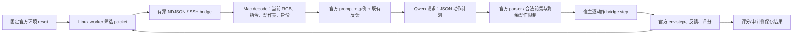
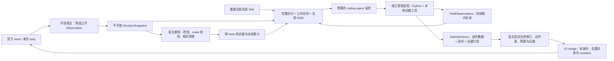

# harness3D 接入 EmbodiedBench：实现前核对与架构建议

核对日期：2026-11-05。范围：EB-Navigation、EB-ALFRED、EB-Habitat；当前九题均为各环境 `base` 前三题。Manipulation、全能力子集运行、Skill 演化不在本阶段范围。

本文与 [实施计划](ARCHITECTURE_IMPLEMENTATION_PLAN.md) 是前置设计产物。文中的新类型、函数、协议版本和命令均为**建议，尚未实现或执行**。本次实际工作只有源码/收据核对、只读 SSH、已有离线合同测试，以及新增前置文档和脱敏回执。

## 1. 推荐结论

推荐组合两种适配方式：以新的具身 Episode 和宿主状态机负责整题交互，把每次决策封装为不可变观测快照；在快照内复用 harness3D 的完整方法交付、Python 程序装配、受限执行、工具授权及证据账本机制，最终提交动作数据，由宿主执行官方环境。

宿主状态机是顶层；快照是程序执行的输入边界。不能原样调用 `online.runner.run_episode()`，也不能原样调用 `SmallImageSolver.solve()`：前者绑定 VSI 静态问答、重建和答案评分，后者仍提交问答答案且没有主 v11 的完整观察/方法交付合同。不能把早期导航文本注入入口当作这个接入的实现。

必须新增四个边界：

1. 具身任务、观测修订号、动态动作表和官方状态的合同。
2. `SubmitActions` 动作提交及宿主校验、执行、重复命令处理。
3. 每次观测对应的感知证据和失效规则，明确单视角相对几何的能力。
4. 在独立、无凭据的执行进程中运行生成程序，并验证文件、网络和资源限制；现有 kernel 本身不是操作系统沙箱。

共享问答系统继续使用原来的默认合同。具身入口显式选择新增控制 profile、具身工具面和独立方法清单，不能改全局 active snapshot，也不能把具身任务映射成 VSI 的八类问答。

## 2. 证据身份与核对范围

### 2.1 工作树与实际源码

| 项目 | 本次核对结果 | 依据 |
|---|---|---|
| 主项目 | `/Users/bytedance/wangjh/wjhICLR`，`main`，HEAD `1c4fb72479967266107ae3015694f5bcb506c8fe` | [local-readonly.json](checks/architecture-preparation/local-readonly.json) |
| 项目 Python | `.venv/bin/python`，3.11.16 | 同上 |
| 未提交工作 | `GPTexp/`、`scripts/BLINKRunner/`、`server.md` 等有既有改动；`embodiedRunner/`、`VSIbench8Brunner/` 为既有未跟踪目录 | 本次 Git 状态核对；后续不能整树 staging、清理或同步 |
| 项目规则 | 本次查找未发现适用 `AGENTS.md` | 根/祖先目录及项目内定向查找；不意味着未来新增规则不存在 |
| Qwen 客户端 | `embodiedRunner/run.py::model_client` 实际读取主项目 `src/skill3d/synthesis/bailian_client.py` | 启动源码及基线 startup 中的客户端 hash |
| 架构复用来源 | 主项目 `src/skill3d/`，不使用 `VSIbench8Brunner/` 的副本 | 本次沿 import 和函数调用核对 |
| 保护清单 | 已记录 230 个源文件的 hash、既有九题基线文件的 hash、active pointer hash | `local-readonly.json::source_sha256`、`existing_baseline_files_sha256`、`active_pointer` |

凭据内容未进入本文或回执；没有打开 `qwenkey.md`、加载在线 key、安装依赖或提交 Git。

### 2.2 官方来源和数据覆盖

固定官方来源：[EmbodiedBench](https://github.com/EmbodiedBench/EmbodiedBench)，revision `9be4e980e9cd6bcb38373cd4aab7c32724bdd401`。结论来自已冻结源码和运行证据；博客仅是背景资料，未用来决定接口。

| 内容 | 本次检查 | 可得结论及边界 |
|---|---|---|
| Navigation 源码/任务 | `official_sources.json` 所列 38 文件，本地、远端大小和 SHA-256 均匹配 | 五个任务子集各 60 题的清单存在；当前九题不覆盖它们 |
| ALFRED/Habitat 官方快照 | `household_sources.json` 所列 553 文件，本地、远端均匹配 | 官方代码身份成立，不等于完整 ALFRED 轨迹就绪 |
| ALFRED 轨迹 | `alfred_pilot_data.json` 所列 3 文件均匹配，数据 revision `af55cc721725ed058830fd7a8aee66c1f69efbaa` | 仅 `base` 前三题的真实轨迹得到本次验证 |
| Habitat 资产 manifest | 本地 hash `c8b4f21cd9049ec05ec7d51f904be712ded47e1441ca81e670724e7c44ba4a0e` | 994 文件，690,475,662 字节；版本/commit 以 manifest 为准 |
| 远端资产位置 | 任务根没有 `habitat_assets.json`；实际位于 `upstream-household/embodiedbench/envs/eb_habitat/habitat_assets.json`，hash 匹配 | 根目录缺文件不能解释成资产丢失；994 文件大小本次全部匹配 |
| 资产字节完整性 | 已有安装回执记录 994 文件验证、归档 692,418,560 字节、SHA-256 `65440e41ef7e928db2aaa8c55fae032cb2188ca55e9ab354883934d8bf450b7e` | 这是既有验证。本次没有再次读取全部资产字节或重算归档 hash |

依据：[local-readonly.json](checks/architecture-preparation/local-readonly.json)、[remote-readonly.json](checks/architecture-preparation/remote-readonly.json)、[remote-assets-layout.json](checks/architecture-preparation/remote-assets-layout.json)，以及任务根的上述原始 manifest。`remote-readonly.json` 的根路径探测为 false，后续 `remote-assets-layout.json` 补充了实际安装位置，应合并解释。

### 2.3 远端环境与资源

远端任务根：`/home/cvailab/wangjh/embodiedRunner`，4090 节点 `10.10.0.198`。

| 环境 | Python/依赖 | 运行边界 |
|---|---|---|
| Navigation | `venv-nav/bin/python`，Python 3.11.14，AI2-THOR 5.0.0，Gym 0.26.2，NumPy 1.26.4 | 既有配置使用物理 GPU 3 |
| ALFRED | `venv-household/bin/python`，Python 3.9.23，AI2-THOR 2.1.0 | 既有 Mesa/Xvfb 软件渲染，`LP_NUM_THREADS=2` |
| Habitat | 同一家务 Python，Habitat-Sim/Lab 0.3.0，Gym 0.23.0，NumPy 1.23.5，Torch 2.4.0+cpu | 既有配置使用物理 GPU 7，映射逻辑设备 0 |

这些版本通过包元数据核对，没有 import 仿真器或启动 `reset/step`。已有真实运行和安装收据提供历史运行证据；本次不能称为重新 smoke 成功。

2026-11-05 09:04:56 UTC 的允许卡采样：物理 0/1/3/7 分别已占用 23,948/20,239/11,403/15,813 MiB，单卡总量 24,564 MiB；GPU 3 利用率 99%。没有据此分配资源。进程 cwd 定向检查未发现任务根进程，但不证明全节点没有相关进程。新任务开始前必须重新查询，并且只能使用项目允许的物理卡。

只读 `command -v` 确认 Mac 有 `/usr/bin/sandbox-exec`，远端有 `/usr/bin/bwrap`、`/usr/bin/unshare`、`/usr/bin/prlimit`。**仅确认程序存在**，未验证策略、用户 namespace 权限或隔离执行。详见 [isolation-availability.json](checks/architecture-preparation/isolation-availability.json)。

## 3. 裸模型运行的独立复核

| 本轮运行 | 成功 | 请求：收据 / 重计 | 动作：收据 / 重计 | 已有 audit | 已记录 total tokens |
|---|---:|---:|---:|---:|---:|
| `qwen-bare-official-suite-nav-3` | 3/3 | 11 / 11 | 30 / 30 | pass，14 项 | 39,937 |
| `qwen-bare-official-suite-alfred-3` | 3/3 | 11 / 11 | 33 / 33 | pass，19 项 | 76,978 |
| `qwen-bare-official-suite-habitat-3` | 2/3 | 13 / 13 | 28 / 28 | pass，19 项 | 57,424 |
| 合计 | 8/9 | 35 / 35 | 91 / 91 | 身份审计，不是全题成功 | 174,339 |

请求和动作由逐题 trace 重计。当前运行器、planner、共用客户端源码 hash 与 startup 记录一致；家务请求/step 记录中的 47 和 44 次图像 hash 引用分别匹配现存 PNG。Navigation 缺少可逐帧重算的保存图像，本次图像检查数为 0，不能声称其历史 RGB 字节也重新验证了。

未重新运行原审计入口，因为它们会写旧 `audit.json`；本次独立核对写入新目录。既有历史导航 `qwen-bare-official-3shot-pilot` 未混入本表。

ALFRED 三题初始动作表分别为 208、218、181 项，证明动作表不能按首题硬编码。第三题 9 请求、14 步、7 次无效动作，其中 5 次为解析错误记录。Habitat 第一题 11 请求、20 步、10 次无效动作后失败，另外两题各 1 请求、4 步成功。现有 hash 和错误类别不能还原原始输出，不能据此归因到模型、解析器或几何；后续只需补充有界格式状态、拒绝原因和动作语法统计，不需要公开模型正文。

当前模型协议为 `qwen3.8-flash`、seed 137、temperature 0、thinking false、max_tokens 4096，单张当前原始 RGB 500×500；Navigation 官方 3-shot，家务官方 10-shot。SDK schema 被 JSON-object 模式替代等已有偏差，以各 planner 的 `DEVIATIONS` 和 startup 为准。保留官方动作语义、反馈和成功判定；没有自有 Skill、prepared geometry 或工具调用。

依据：[official-suite-summary.json](runs/official-suite-summary.json)、各上述目录的 `startup/config/summary/audit`、`episode-*/trace.jsonl`，本次复核见 `local-readonly.json::runs`。

本次实际离线测试为 `test_official_bare.py` 全部四项及 `test_household.py` 的 head RGB、原始 prompt/message、空/非法/合法前缀解析、动态动作表/反馈四项：**8 passed，4 subtests passed**。使用假客户端、清除服务凭据和端点、新 basetemp、禁用 pytest cache，没有 live check 或任务选择入口。命令与范围见 [offline-contracts.json](checks/architecture-preparation/offline-contracts.json)。这些结果覆盖现有基线合同，不覆盖尚未实现的新架构。

## 4. 文档、交接和源码之间的差异

| 容易误用的描述 | 当前源码/证据 | 设计影响 |
|---|---|---|
| 主 README 的历史提示词/旧默认值 | `synthesis/prompt_builder.py` 普通轮 `program_synth_v11_14_en`、终结 `finalization_v11_4_en`；`online/submission.py` 为 `solver-v11.13-evidence-boundaries` | 用源码身份，不继承 README 中 `program_synth_v11_8` 或旧 S0/task-tools 说明 |
| “有 v11 就能运行任意 Episode” | `online/runner.py::run_episode` 处理 VSI Episode、重建、M5、答案评分；`routing/task_classifier.py::canonical_task` 限定问答类型 | 增加具身任务合同，不能伪造问答题型 |
| “SkillSpecV11 类型本身只允许八类” | `schemas/skill.py::SkillSpecV11` 的字段验证是通用格式；实际限制在 `skills/v11_library.py::load_skill_source_v11/validate_v11_snapshot` 的 `TASK_TYPES` 检查 | 不应修改 schema enum 来“解决”；要独立具身方法清单/路由 |
| “可以直接传任意 Skill 对象给 delivery” | `skills/delivery.py::render_skill_entry` 对 `SkillSpecV11` 有显式完整正文分支 | 增加明确类型和渲染分支，禁止无声降为摘要 |
| “kernel 跨轮变量永久保留” | kernel 是 in-process；`online/runner.py::_execute_program` 每次重执行调用 `reset_user_namespace`，host 账本保留 | 用户变量不作为交互记忆；旧 result 仍可追溯，但必须重新判定使用资格 |
| “small-image 就是轻量 v11” | `small_image/runner.py::build_solver_prompt` 明确不支持 `ReadObservation`，采用独立 skill_text 和问答终结 | 复用感知后端/数值处理，不照搬 solver |
| “候选框/类别通过即可算对象深度” | `small_image/tools.py::build_registry` 的 `candidate_depth_summary` 当前总是拒绝；`precompute.py` 另有候选几何要求 | 不能把 capabilities flag 当成已经实现的可信 mask 几何 |
| “同视角点距离是世界距离” | `small_image/tools.py::sample/point_depth/pair_point_distance` 读取相对单位，同一 view 才允许 pair | 不做跨轮米制或世界坐标推断 |
| “桥接已经防止重复动作” | `bridge.py::request` 和 `HouseholdBridge.request` 校验序号/版本；没有命令去重、expected observation 或动作表 guard | 必须新增 V2 mutation 合同，超时停止且不自动重发 |
| “Habitat 根 manifest 缺失” | 安装目录内找到同 hash manifest，994 大小检查通过 | 路径偏差已解释，当前无需下载资产 |
| “九题成功率就是方法验证” | 九题已参与环境接入；没有完整架构新方法运行 | 作为开发样本，独立验证/最终测试另选 |

当前其余身份：`execution-contract/5.1`（`synthesis/execution_contract.py`）、`tool-docs-v11.13-evidence-dependencies`（`tools/docs_v11.py`）、`tool-face-v11.12-runtime-dependencies`（`tools/registry.py`）、`tool-response/2.0`（`schemas/tool_response.py`）。active 为 `mixed-r04-20261026-v1`，snapshot hash `4425c0e6509bfcdfbc8dbf850ca83f715105173a5f2c545882db78134e6b1c85`，24 个 active source refs 验证通过，schema 为 `runtime-skill-snapshot/3.0`。详见 [snapshot-readonly.json](checks/architecture-preparation/snapshot-readonly.json)。

## 5. 两条端到端调用链

### 5.1 现有官方裸模型

Navigation：`bare_run.py` → `run.py::model_client` → `official_bare.py::OfficialBarePlanner.messages/act` → `runner.py::evaluate` → `bridge.py::SimulatorBridge.open/step/request` → `remote_runtime.py` → `simulator_worker.py::OfficialNavigation.open/step/_packet` → 固定官方环境。`protocol.py::decode_transition` 区分 Observation 和 Transition。

家务：`household_run.py::evaluate` → `household_planner.py::adapter/OfficialHouseholdPlanner.messages/act` → `HouseholdBridge.request` → `household_worker.py::OfficialHousehold.open/step/invalid/packet`。每题 reset planner 的真实动作表；Habitat 通过 `observations_to_image(obs, {}, key="head_rgb")` 输出当前 head RGB，不能第三视角/深度拼图。`native_log` 捕获 Python 及原生 fd 输出，通信另走独立 fd，必须保留。

家务 `act` 将格式错误标为非法计划，宿主调用 `invalid`；该操作增加官方无效动作计数但不执行 `env.step`。正常计划保留官方 parser 的合法前缀语义，逐个执行，失败/done 后重新规划或结束。Navigation 采用官方 action ID 和剩余动作上限；早期 `planner.py` 的两动作 cap 不作为本轮官方合同。

原 packet 含 `task_success/task_progress/reward/done` 等评分字段，保留在宿主/审计侧。模型观察的白名单是当前图像、step、公开指令、官方动作表、输入身份，以及通过官方 planner 整理的反馈。模型不得获得原始 packet、内部轨迹、GT 位姿或评分对象。

只有 Qwen 请求是真实模型调用；worker `reset/step` 是仿真操作，不能与模型请求混计。当前 Direct 感知/几何/程序工具计数均为零。

### 5.2 推荐接入方法（待实现）

生成程序只能访问冻结当前像素、只读公开 context、获准数值工具和终结控制接口。真实模型、感知 HTTP、SSH、环境对象、reset/step、评分器和凭据均留在可信宿主或其服务进程，不能透传给 sandbox。

感知在快照执行前准备，或同快照 `YieldObservations` 后由宿主按预算补充；工具执行时只读已经准备的局部证据，不在子进程持有 HTTP 客户端。一个快照的证据扩充另增 `evidence_revision`，不偷偷修改现存数组/结果。yield 不能执行环境动作，也不能免预算地让另一模型提供规划答案。

普通合成及纠错轮完整交付同一冻结 Skill；`ReadObservation` 只读本次决策的有界结果。初版具身协议不采用原 QA 的省略全文终结轮或 no-tool 答案兜底，避免出现预算外动作规划渠道。到达请求 cap 后由宿主记为预算耗尽，不再询问模型。

每次真实环境动作结束当前生成程序。宿主可以执行已验证的开放式计划前缀，但该程序不能跨动作恢复；需要当前几何的后续决策必须取得新 RGB 并生成新程序。

## 6. 接口复用清单

| 组件与定位 | 当前能力 | 建议复用方式 / 必须新增 |
|---|---|---|
| `synthesis/bailian_client.py`、`run.py::model_client` | 既有 Qwen 参数和响应身份 | 复用可信宿主客户端；所有实际调用挂统一预算，禁止传入生成代码 |
| `synthesis/program_assembler.py::extract_program_source_ex/assemble_program_ex` | 提取 Python、恢复标记、程序 hash，已有 `intended_answer_slot` 参数 | 可直接装配，以新槽名 `SubmitActions`；装配支持槽名不等于 kernel 已支持动作 |
| `schemas/skill.py::normalize_skill_markdown/parse_skill_markdown` | 规范化全文和 metadata | 复用纯解析；独立 `FrozenMethod` 和具身 manifest 校验，不扩展 VSI snapshot 槽位 |
| `skills/delivery.py::plan_delivery/render_skill_entry` | 全文交付、hash、发出/未发出/失败身份 | 明确增加冻结方法类型分支；保留 QA 分支行为，超长方法拒绝而非截断 |
| `synthesis/prompt_builder.py`、`execution_contract.py` | QA 公共合同、工具/终结约束、图像消息 | 复用设计和底层格式；具身 prompt 独立构造，默认一图，不采用默认 max_images=32 |
| `synthesis/request_governor.py::RequestGovernor/GovernedClient` | 发出前保留请求额度、并发 cap、脱敏 numeric usage | 复用 run-local 总额度；新增 episode/stage 额度，所有模型角色计入总数。它当前不是硬 token 上限器 |
| `sandbox/ast_guard.py::ast_guard`、`action_check.py::check_action` | AST 白名单和 QA 控制名、Answer/Yield 检查 | 引入显式控制 profile；动作模式禁止 Answer 和 host I/O，QA 默认行为不变 |
| `sandbox/kernel.py::RestrictedNamespaceKernel` | 只读 frames/context/tools、超时、结果/授权账本、ReadObservation | 增加动作 profile 与公开 context；外包独立 OS 限制执行进程，不能直接给 SceneHandle/环境对象 |
| `online/runner.py::_synthesize/_execute_program` | 交付/装配/执行/回执连接 | 抽小型受信任 segment 边界，不复制私有大循环；`_solve_program/run_episode` 不作为具身入口 |
| `online/observation_reader.py::read_observation/reader_contract` | 分页、字段白名单、读取次数和 receipt | 复用有界机制，增加决策/结果作用域；不能把读取 receipt 当普通工具授权 receipt |
| `online/submission.py` | AnswerPayload 引用检查、used evidence 归属 | 复用引用审计思想；新动作 validator 独立，不能调用答案终结/QA score |
| `tools/registry.py::ToolRegistry`、`schemas/tool_response.py` | 参数 schema、授权 callback、统一 response | 实例级具身 registry 和 authorizer；不改全局 REGISTRY/VSI task_policy |
| `small_image/backends.py` | DINO、SAM2、Intern 类别核验、MoGe2 适配 | 宿主可复用已明确身份的后端，部署/调用待授权；类别模型不能顺带给动作答案 |
| `small_image/precompute.py::SmallImagePrecomputer.process` | 支持白名单 Mapping、原图、候选/mask/相对深度/points/来源 hash | 用真正具身局部输入 adapter；不伪造 `SmallImageProblem` 或加载其他 benchmark prepared |
| `small_image/storage.py::save_prepared/load_prepared` | hash 验证和数组存储 | 复用编码/hash机制，具身存储加 observation/evidence revision，create-once，不替换不同内容 |
| `small_image/tools.py::build_registry` | 当前 view 候选、数值相对深度、同 view 点距 | 使用具身作用域 wrapper；候选对象几何当前未开放，不能直接打开 flag |
| `segmentation/`、`infra/m5_identity.py`、重建/`verifier/` | 静态 FrameSet 对象绑定、身份和质量门 | 可迁移来源核验/独立 mask 审查思想；跨时刻对象跟踪和运动失效必须另建，初版不用世界重建 |
| `evaluation/skill_ablation_v11.py/direct_qwen_v11.py` | QA paired/frozen identity、Direct隔离思路 | 借用隔离原则和统计；官方具身评分/初态/轨迹计数另实现 |

## 7. 三环境的共同层与特有层

| 维度 | Navigation | ALFRED | Habitat |
|---|---|---|---|
| 动作 | 固定 8 个：前/后/右/左 0.25 m；右/左旋转 90°；相机上/下 30° | 场景相关高层动作表，首三题 208/218/181 | 当前官方 70 个高层动作 |
| 环境 cap | 20 动作 | 30 动作，10 无效 | 30 动作，10 无效 |
| 示例 | 官方 3-shot | 官方 10-shot | 官方 10-shot |
| 初态身份 | subset/index/input hash | 指令、轨迹 identity、动态动作表 | 实际 episode ID，shuffle=false，group_by_scene=false，seed=137 |
| 视角 | 当前第一视角原始 RGB | 当前原始 RGB | 当前 `head_rgb`，不拼第三视角/深度 |
| 主要更新风险 | 转身低视差、动作失败不能积累确定 pose | 对象移动、持有/开关改变、find 高层跳转 | 高层导航/交互，不能把每步解释成固定相机增量 |
| worker 特有逻辑 | `OfficialNavigation`、first_in_plan | `init_alfred` 和软件渲染 | `init_habitat`、episode核对、native fd日志 |

共同层负责 action ID/表 hash、预算、提交、去重、快照、证据失效和回执。环境 adapter 负责读取原官方动作/反馈/评分和 packet 白名单。不能换控制粒度、重写评分或利用官方内部导航位姿。

## 8. 方案比较与选择

| 方案 | 改动和适配 | 状态 / 复用 | 可比性、成本和回归 |
|---|---|---|---|
| A：具身 Episode + 动作提交适配 | 新宿主 FSM、三个 adapter；共享 kernel/交付采用 opt-in profile | 整题身份清楚；动态动作表和官方结束有唯一 owner | 可固定三臂同宿主协议；共享 AST/kernel/交付必须有 QA 回归 |
| B：每个决策快照复用求解组件 | 每步构造局部 immutable input，抽出 segment，而不是直接调现有 run_episode | 同快照 yield 可复用工具账本，跨动作清空变量/撤销旧引用 | 调试和重放容易；要由外部 host 补上 A 的 episode/预算/去重，不能独立承担整题 |
| C：直接改 small-image solver | 感知路径适合 1 张图；仍要重做 Skill、ReadObservation、动作/隔离合同 | 后端可用，但 solver 控制语义和评分仍是 QA | 表面改动少，实际上容易形成第三套求解协议；不推荐作为顶层 |
| D：复制完整 v11 runner | 复制约 3,700 行及私有状态/恢复分支，再换动作 | 与重建、VSI路由、QA结束强耦合 | 协议长期分叉、审计易错、每次上游更新重复维护；不推荐 |

**选择 A+B。** 不可变快照让动态观测局部化；宿主 FSM 保证环境交互只有一条写路径。初版仅使用当前 RGB、单视角相对几何与独立具身 Skill；跨帧重建/跟踪是后续可选版本，不作为接入先决条件。

## 9. 关键设计决定

- 初版独立三个具身方法 family，可包含同一全文中的“仅 RGB / 当前相对深度可用”分支。方法整题冻结；工具权限随观测能力变化，不重新发布方法。完整 schema、提交字段和 FSM 见实施计划。
- 动作提交只能返回 action ID、版本、可审计证据引用及允许的公开记忆更新。`ReturnAnswer(True)` 不合法；模型空计划是停止请求，不是成功。
- 真实动作后所有当前几何、result ID 和对象绑定使用资格失效；审计账本保留。持有/开关状态只从允许的官方反馈和当前视觉证据推断，保留来源与不确定性，不能读私有 inventory。
- 原始官方反馈文字可能含持有/容器线索，它是已有允许反馈；不能借“过滤 GT”名义删去 Direct 已有信息，也不能扩成全模拟器 metadata。
- 官方标称动作量是控制知识。失败动作、高层 find/nav 和纯旋转不能提供已知真实 pose 或可信跨视图尺度。
- 多动作默认保留官方开放计划前缀：宿主每个 action 前检查预算/表/环境状态，失败/done/表变化即截断；若后续动作需要新的几何判断，则必须截断并重新决策。批执行与证据依赖规则三臂同协议登记。
- V2 worker 在 mutation 前验证 command UUID/digest、session/episode、mutation revision、expected step 和动作表 hash，并缓存响应。断连导致执行是否完成未知时终止，不能重发、重置或回放；不宣称跨进程崩溃的 exactly-once。
- 初版所有程序轮使用全文 Skill，不移植 QA 的省略全文 finalization 或视觉兜底。B01/B11 的公共合同、工具、预算、纠错和所有输入规则完全相同。
- Direct 与完整系统的结果衡量系统差异；B01/B11 才隔离全文 Skill 变量。新增图、历史帧、候选/深度可视化、反馈或 perception 调用必须记录，不暗中给予其中一臂。

## 10. 待验证项与下一阶段边界

| 事项 | 当前证据 | 推荐处理 |
|---|---|---|
| OS 隔离策略可用性 | 已找到 sandbox-exec/bwrap，未验证实际限制 | 实施批准后先做无网络、假输入的隔离测试；策略不可用时阻止 live，不降回持 key 的进程执行 |
| 新 profile 与 QA 行为兼容 | 已定位保留名、Answer/Yield槽、namespace reset、SceneHandle耦合 | 先抽稳定 segment，跑 existing QA 合同，再接具身动作 |
| 可信 mask 几何 | 当前 candidate geometry 工具拒绝，类别确认与表面校验分离 | 初版只开放已验证的 per-view点工具；可靠 mask 几何单独定义并测试，不能无条件启用 |
| 全量 ALFRED 数据 | 本次只验证三条轨迹 | 独立验证/最终实验启动前准备对应真实轨迹清单并验证，不在本阶段补下载 |
| 新方法质量 | 尚无具身完整 Skill/新方法运行 | 在开发集创建并冻结方法，再用独立验证集选择；九题保留开发身份 |
| live 容量/预算 | 当前允许卡多数已有较高占用；候选预算未实测 | 先独立授权三环境 smoke，再冻结 pilot 预算；不虚构吞吐或工时 |
| 服务和格式异常根因 | 保存类别/hash，没有原文 | 后续补最小脱敏状态证据，当前不复跑历史模型请求 |

这些问题不阻止交付本次方案。实施第一步是保护现有工作树、绑定源码身份，然后抽取 segment 和新增合同，在假输入下验证。源码修改、配置、方法正文、部署和新 live 请求均等待用户批准；后续 live 执行还需对应阶段授权。

交付前再次按原收据验证：230 个源文件、103 个既有基线文件的 SHA-256 全部不变，全局 active pointer 不变，两份文档的本地链接均存在。见 [final-verification.json](checks/architecture-preparation/final-verification.json)。
