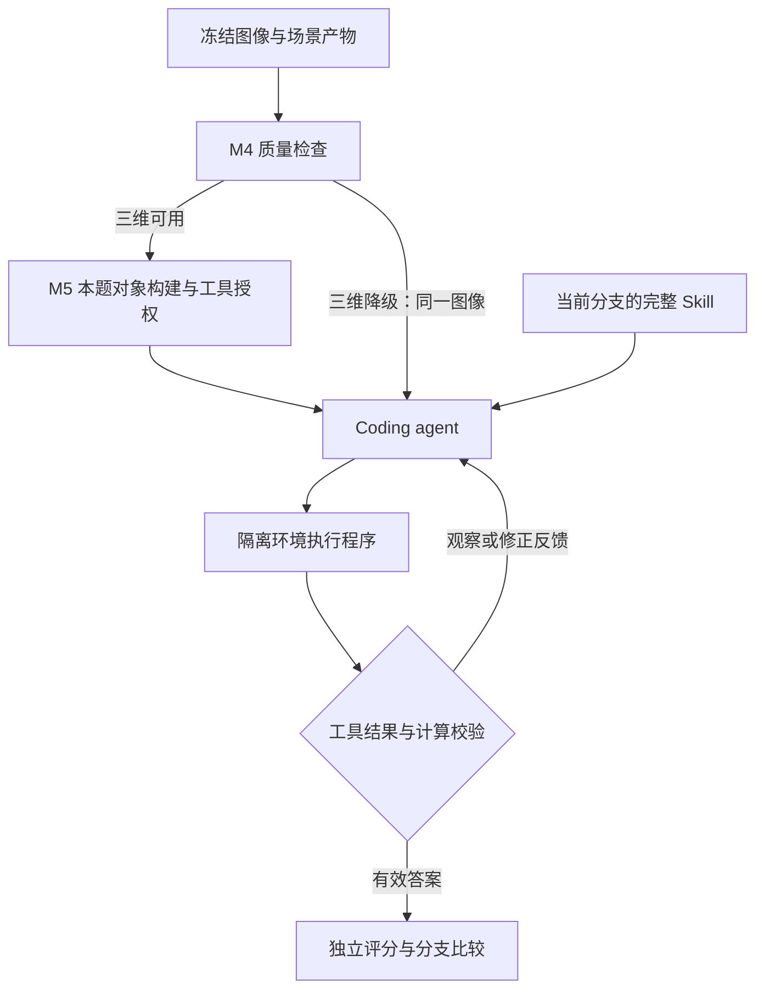

# harness3D 系统架构 v11：Skill 指导的可校验 3D 代码推理

> 版本：11.0-draft｜日期：2026-10-15｜本次代码核对基线：`main@3c8a1467210fcaf2cb996e3939d50a26e1afd54b`
> 性质：当前实现合同；性能变化须以独立验证记录为准。
> 本次目标：将全部在线多模态调用统一为百炼 Qwen3.8-Flash；M5 使用问题解析、GroundingDINO 全冻结帧扫描、逐帧 SAM2、目标盲审和最小绑定验证；保持 Skill 对比、整场质量门与标签隔离合同。
> 阶段：M5 新路径代码实施与验证中；当前状态见 §8，Git 同步另行确认。

## 1. 研究目标与范围

系统围绕两项待实验验证的核心主张展开，并将工具质量校验作为两臂共同启用的已确认基础条件：

| 定位 | 系统实现 | 本版处理 |
|---|---|---|
| **待验证主张 1：类沙箱机制下的 Skill→代码对比实验** | 同一个 coding agent 在隔离执行分支中分别接受无 Skill 或冻结 Skill，生成并执行代码 | Skill 是否改善程序行为与答案？改进是否来自方法内容？ |
| **固定基础条件：对工具使用进行校验** | 检查重建质量、工具前置证据及返回结果，在程序使用前授权、使用后核验 | 几何质量校验已确认有效；本版固定开启，不再设置关闭臂或重复验证其收益 |
| **待验证主张 2：将 Skill 指导生成代码引入 3D 推理** | 将对象关联、坐标、距离、方向与尺度规则写成方法，指导代码组合感知和几何工具 | 领域方法是否改善空间计算与证据使用，而不仅是改变回答措辞？ |

这里的 coding agent 是“读取题目、图像、方法和工具接口后生成程序的在线 agent”，当前固定为百炼 Qwen3.8-Flash。Skill 演化负责提供可比较的新方法，是支撑流程；主贡献不以两代晋升次数或治理模块数量定义。

原 Skill-3D 已有场景相关方法和工具使用策略。[R3] 因此第二项待验证主张应表述为“将 Skill 指导的代码生成与执行用于可校验的 3D 推理”，不能仅以“Skill 用于 3D”宣称首次；区别应落在程序执行、固定工具校验及受控实验结果上。

保留八类 S0 方法。计数继续作为工程冒烟与既有演化回归；核心实验至少增加一个已有的几何题型切片，优先 `object_rel_distance / S03`，避免只凭计数结果声称验证了 3D 计算。先做冻结 S0 的核心对比，再按需运行单题型两轮修订；独立泛化在方案冻结后验证。

## 2. 相对 v10 的删减

下列为 v11 的设计选择，替代 v10 对应要求；不是对历史运行的重新解释。

| v10／历史机制 | v11 主线 |
|---|---|
| 每谱系两个在线版本竞争、模型单独选择版本、第三版历史化 | 每谱系一个活跃版本；发布时替换指针，旧版本只供对照与回滚 |
| top-k、向量排序、reranker、独立选择请求 | 首期按规范题型查找唯一活跃方法；没有方法就以公共求解合同运行 |
| `program_synth_v8`、早期 v11 提示词及对应执行分支并存 | 当前运行时只保留 `program_synth_v11_5_en`、`solver-v11.5-core-engineering-repair` 与 `tool-docs-v11.5-core-engineering-repair`；历史复现使用对应 Git 提交 |
| 13 个演化状态和多类独立收据 | 演化作为辅助的四阶段流程；核心先跑质量门固定开启的 Skill on/off 受控对比 |
| L1/L2/L3、反例搜索、分支优化、独立模型审查等旧治理链 | 不进入本轮主流程；直接评测一个完整候选 |
| 双 seed 作为固定准入门 | 首期一个预先冻结的请求 seed；若预登记多个，则逐一真实传入并全部通过 |
| 仅工具名交叠／自声明支持的轨迹可学习 | 已交付且身份完整的 learning 轨迹可学习；使用线索只作诊断 |
| 每个 Skill 固定 11 个章节及大段相同执行合同 | 精简方法正文；公共约束由框架统一注入；空章节删除 |
| Memory 数据库、成熟度阶梯、复杂成本门、额外平台建设 | 不作为核心实验前置条件；沿用必要缓存，成本只报告 |

这里的“删除”对运行代码是字面含义：当前 checkout 不保留历史提示词、工具文档、旧
M8–M11 编排或旧快照的在线兼容分支。历史实验结果、trace 和不可变快照可以作为只读证据
保存，但当前代码不承诺重放；需要复现实验时 checkout 对应 Git 提交。测试只保留仍约束
当前合同的部分，不因文件名带 v9/v10 就机械删除。单活跃版本取消的是线上竞争，父／候选
的离线比较仍保留。单 seed 只服务开发实验，不构成稳定性或统计显著性证明。

## 3. 最小系统结构

| 模块 | 输入与输出 | 复用位置 |
|---|---|---|
| 3D 方法库 | 题型与快照 → 一条完整 Skill | `skills/`、`routing/` |
| M5 对象构建 | Qwen3.8 解析 → 全冻结帧检测 → 逐帧 SAM2 → 目标盲审 → 本题对象 | `segmentation/`、`infra/m5_identity.py` |
| Coding agent 与执行环境 | 图像、方法、工具接口 → 程序、执行轨迹、答案 | `online/runner.py`、`synthesis/`、`sandbox/` |
| 工具校验层 | 场景产物、调用参数与结果 → 可用性、违规和修正反馈 | `reconstruction_gate/`、`tools/contract.py`、`verifier/` |
| 实验驱动器 | 冻结输入与分支配置 → 逐题配对结果；可选方法修订与发布 | `evaluation/skill_ablation_v11.py`、`evolution/campaign_v11.py`、`governance/` |



在线只保留一条求解循环：冻结输入与快照；执行或复用 M4 与本题 M5 前置；按题型加载方法；
同一个 Qwen3.8-Flash 看图生成程序；执行工具；必要时把观察送回下一轮。所有
`C1_tools_program` 入口固定使用公共提示词 `program_synth_v11_8_en`、执行协议
`solver-v11.8-task-tools` 和工具文档 `tool-docs-v11.8-task-tools`。三者是必须落盘的当前
合同身份，不是可由 YAML／CLI 切换求解语义的实验参数。`ReturnAnswer` 只暂存本轮提交，
M11 使用当前轮及历史未失效结果做确定性验收；通过后才独立评分，失败则撤销受影响结果、
清空暂存答案并把结构化原因反馈给同一个 Qwen3.8-Flash。沿用当前求解轮数及有限重试配置，
不再增加选择轮、审查轮或专门的修复 agent。

模型公开目录为 13 个工具，四个观察接口对全部题型开放；七个空间题型保留质心和
重投影辅助能力，计数、尺寸、面积、方向和排名接口按题型限制，每题最多展示 4–8 个。
两个对象表面距离接口合并为 `object_surface_distance(obj_a, obj_b, unit)`，
米制模式按实际参数追加尺度依赖并检查题级授权；归一化模式不输出米制值。
提示词与调用共用题型规则，历史六个入口仅保留内部兼容。M11、恢复依赖撤销和
计算重放均读取实际单位；Skill 仍由初始状态选定并固定整题。

视觉终结是评测专用的增量层，不替换上述循环。只有 `inner_validation`、
`outer_holdout` 或显式授权的 `final_test` 在完整求解与原终结轮之后仍为
`run_error`，才预算外发出一次 `eval-visual-v1` 请求；`induction` 永不启用。
该请求不延续模型消息历史，只包含同一冻结 FrameSet 的 32 张原帧、query、选项和必要的
字母／数值答案模板，不携带 Skill、场景摘要、工具结果、程序、失败反馈、裁剪图或标准
答案。框架关闭该请求的 SDK 隐式重试，严格解析一个字母或一个有限非负数；非法输出和
服务失败不再重试。正常提交即使评分错误也不触发，因此触发判定不读取 GT。成功补答记为
`visual_estimate`／`direct_vlm_routed`，同时保留原 `terminal_failure`、程序轮次、
工具审计及补答前得分快照。B01、B11 与 E11 两臂使用同一开关和请求合同。

**M5**：问题对象解析 → GroundingDINO 全帧检测 → 逐帧 SAM2 → mask 结构预检 →
Qwen3.8-Flash 目标盲审 → 纯文本类别关系判断 → 深度反投影与最终验证 → 本题工具。
仅构建本题对象，取消通用清单前置。独立百炼 Qwen3.8-Flash 读取
`question / question_type / options`，严格 JSON 示例：
`{"objects":[{"category":"cup","role":"target","source_text":"cup"}]}`。
只提取有题面或选项依据的物理对象、路线地标，排除方向、动作、单位、视频、机器人；
类别用常见英文单数名，source_text 必须原文命中，去重但保留不同角色。最多 16 条；
温度 0、请求级 seed，保存模型／prompt 版本、请求哈希与原始响应。校验失败至多一次
确定性格式修复，仍失败则解析不可用，不以词表补造对象；在线请求不读答案、评分或 GT 3D。
角色：计数／尺寸／出现顺序为 `target`；绝对距离为 `target_a / target_b`；相对方向为
`observer_anchor / facing_anchor / target`；相对距离为 `reference / candidate`；
路线为 `start_anchor / facing_anchor / waypoint / destination`；房间面积无需对象解析。
每个解析类别扫描全部可读冻结帧（正常 32 帧），不足时保留输入降级；不设部分扫描模式，
不因已有同类或发现候选跳过／提前结束，不只探测第 0／16 帧，不改变或重采样冻结帧。
`OBJECT_VOCABULARY`、`SYNONYMS` 不决定扫描对象，也不作为模型失败的猜测兜底。
每帧同类可作确定性 NMS，保留原框、分数、帧索引及请求收据；检测器超时、连接失败、
429、5xx 的有限重试独立记账，最终故障不以 VLM 框或伪候选补位。
NMS 后每帧只执行一次 SAM2 image encoder，各框独立分割，不做时序传播。目标盲审每个
候选只看无类别文字的完整帧、原 crop 与 mask crop，先冻结 `observed_object`、可见性、
纯净度和完整性，再用独立纯文本请求与题目类别比较；不匹配正常拒绝，模糊、请求失败、
ID／JSON 错误均关闭该候选。通过后才生成局部点云；实例关联使用同帧互斥、稳健世界质心、
局部 bbox 和 complete-link，歧义对象保留 suspect 并关闭几何。

多实例参照不静默取首项。
相对距离工具保留逐实例测量与降级标记，缺候选、不可测实例、身份冲突或最小值并列时
不给最近类别。M11 与 derivation 共用排名合同，并按本题实际选项核对覆盖与映射。
接近但不相等的距离仅记录 margin，尚未标定近似并列阈值。后续纯视觉零工具提交仍可
舍弃历史几何；局部排名失败不撤销整个场景的几何前提。检测器只对超时、连接失败、
429 和 5xx 作有限重试，重试尝试与最终未恢复故障分别记账。
本次不修改冻结 Skill；两臂使用相同 M5 结果，不能将 M5 变化解释为 Skill 收益。

M4 重建主门通过只说明跨视图几何达到冻结阈值，不证明对象类别与 mask 绑定正确。
候选、track、类别、角色保留身份映射；mask 用深度／内参／c2w 反投影到世界系。
最小验证：mask 非空且有正有限深度点；visible_frames 与保存 mask 严格一致；有限非空
点云与提供的逐点置信度同序同长；质心／bbox 从保存点云重算，去重后全部字段同源。
明确不相容标签的 mask 在至少两个共同非空帧堆叠 IoU ≥0.95 时硬拦。检测分数、
帧支撑率及 depth_conf 不认证语义；存疑框／mask／track 不算通过，计数保留全部可用实例。
解析、检测、SAM2、绑定或验证失败关闭相关对象几何，不等于不存在；可继续冻结图像
二维求解，失败、降级、无答案保留评分分母。

授权的房间题在两臂求解前以独立子进程共享预计算一次 `plane_fit_room_size`，300 秒
上限；成功 payload 或失败／超时状态都随 frozen tree 固化。收据绑定 point-map
SHA-256、米制尺度、原语参数、实现源码、冻结输入身份和 payload，运行时只允许验证后
读取，身份不符时禁止臂内重算。`fit_quality` 使用
`sqrt(floor_fit_ratio * ground_planarity)`；`plane_inlier_ratio` 仍表示地面内点占
全部点的比例。`plane_fit_low_quality` 尚未标定，只作审计。共享预计算是 B01/B11
共同基础设施，不是 Skill 产出，也不得计作 B11 收益。

对象、结果、调用与共享前提继续按已有规则区分失败范围。
`FailureCause` 的局部对象原因只撤销消费该对象的结果；未受影响对象与共享尺度继续有效。
共享深度、位姿或米制尺度确实失效时才按对应前提级联。NameError/UnboundLocalError
使用同 AST×同证据的执行前重复保护。观察摘要先保存候选身份与 flags，再补质量字段；
完整审计内容保存在结果和轨迹。

答案解析、M11提交与独立评分分别记状态。空GT的已解析预测保留，score/correct/MRA
为空；不得用假零分判断合法性。M11执行状态及最终引用质量由真实执行和结果依赖链汇总。
现有扩大面板和暂停实验保留原输入、版本与记录，不自动恢复；新 M5 结果
另建基线，不写入旧冻结树。完成答案冻结后仍由独立进程评分。

M5 缓存采用“对象解析＋本题绑定”：角色对应清楚，但跨题可能重复检测；场景＋类别
复用省成本、关联更复杂，暂不实施。身份绑定帧及顺序、问题／选项／题型、
重建、GroundingDINO／SAM2／Qwen、prompt／seed、参数、环境与源码；升级生成和缓存版本，
缺身份不复用，旧产物只读。准备为 M4 → M5 → 本题 SceneState／SceneHandle、证据和权限；
G7/G9 只诊断，统计用本题分母。paired preparation 冻结两臂相同 M5 结果，臂内不重检。
Qwen mask 语义核验仅为候选：冻结帧／裁剪／mask 加目标原文，判 match／mismatch／uncertain；
新增视觉请求且同模型错误相关，须单独批准。NMS IoU=0.7；同实例合并需 mask IoU≥0.8
且质心距离＜深度中位×0.15；提示帧 mask 至少一半在框内；数值容差为 1e-6，尚未标定。

下列七条属于正确性条件，不能为简化而删掉：

- 同一 episode 固定输入与快照；成对比较使用相同实际帧集、基础产物和模型配置。
- 有可读图像时继续求解；感知失败只关闭依赖该证据的工具。全部图像不可读则记输入错误，保留评估分母。
- `QuestionState` 继续管理题级绑定、证据与失效；工具文档和执行权限共用同一判定。
- 新图像／工具观察实际进入模型请求才记已观察；失效结果不能继续支持答案。
- 在线求解期间，coding agent、工具和沙箱不读标准答案或 GT 三维标注，评分器独立持有
  标签；离线 Skill 修订阶段可以按 §6 读取 `induction` 的题目级标准答案与评分，但这
  不得改变在线求解的标签隔离。
- 演化期冻结模型、工具、阈值、评分器与求解预算；系统改动另建基线。
- `SkillSpecV11`、公共提示词、工具文档和执行协议作为不可拆分的运行合同校验；任何旧格式或版本错配必须在首次模型请求前失败。

VGGT、可选 MoGe-2、GroundingDINO／SAM2 复用现有模型。研究重点是 coding agent 如何在
Skill 指导下使用工具并校验可靠性；不新增重建主干、训练系统或对象质量平台。

### 3.1 类沙箱执行与核心对比

这里的沙箱首先是**可控的程序执行与分支隔离机制**。每个实验臂使用独立程序命名空间、题级状态、临时输出和结果登记；只共享只读图像、冻结重建与同一份本题 M5 结果，不共享另一臂的答案、程序变量或运行记忆。保持相同代码能力和预算，不要求为本研究建设完整容器安全平台。

核心实验只保留 B01／B11 两臂，所有组均由同一 coding agent 生成代码并执行：

| 实验组 | 方法指导 | 几何质量门 | 比较目的 |
|---|---|---|---|
| B01 | 无 Skill | 固定开启 | 共同 coding-agent 基线 |
| B11 | 冻结 S0 Skill | 固定开启 | 主系统；B11−B01 为 Skill 对程序行为与答案的效果 |

两臂使用完全相同且固定开启的几何质量门、工具前置检查和结果合同；质量指标、授权结果与违规仍进入 trace，但不是本版实验自变量。B01／B11 的唯一方法变量是是否交付冻结 Skill，因此不得从两臂差异推断质量门收益。B00／B10 不进入主实验，也不为本版新增质量门关闭路径。

B01 和 B11 天然使用唯一的当前公共提示词、工具文档与执行协议，不再各自配置模板版本。
普通在线入口、配对入口和发布后运行必须调用同一个 solver；不得为实验入口保留一套
M11 可重入语义、而让普通入口使用另一套旧语义。

后续比较修订方法时，增加 E11：仅把 B11 的父方法替换为候选。无 Skill 对比用于证明方法指导价值；候选准入仍与父方法比较。共享图像、模型、重建、接口、公共提示词和预算，各臂必须独立生成程序。最终系统成绩通过正常方法加载获得，固定注入只是控制实验变量。

若进一步主张“生成程序”优于直接工具规划，再增加一个 T11 参照：使用同一 Skill、工具与校验，但直接输出工具调用，由框架串行执行，不生成自由程序。T11 与 B11 隔离行动表示的差异；它是受控机制对照，不冒充完整复现 Skill-3D。B01／B11 主实验本身不支持“代码优于非代码”的结论。

按题型报告官方 Accuracy／MRA、合法答案率、程序错误率，以及不可信几何被实际使用的次数；补充首次重建、M5 请求与运行成本、生成轮数和工具调用数。独立评分器评答案，校验器判工具与计算合同，不用另一模型当最终正确性裁判。不要以工具调用更多或门通过率更高替代 Skill 带来的答案收益；质量门相关统计只作固定基础设施的诊断。

### 3.2 固定工具校验合同

- **产物质量**：按 2026-10-14 简化版方案，M4 对整场计算 warp 内点率、分组点云重叠率、两重建头相对差 P95 和邻域距离长尾比，四项全部满足才通过；不通过则整场二维降级。新增统计共用全部冻结帧的步长 16、偏移 4 网格，M4 只评估整场，不把 M5 对象验证并入主门、不增加逐点管理。质量版本为 `v7-scene-warp-overlap-head-tail`，旧两项质量可读取但必须用原数组重新计算、另存新版收据；缺失或非有限值不记通过。新增 0.15 / 3.0 为候选阈值，独立场景验证后才能进入新正式实验。模型 confidence 保持既有辅助职责。
- **对象绑定完整性**：按前述 M5 最小验证检查 mask／点云／字段一致性及明确标签冲突，未通过或存疑的对象几何不可用；结构通过不等于语义认证。
- **调用前置条件**：按具体工具检查对象绑定、有效产物、世界系与尺度。相对距离排序不必有米制尺度；米制距离和面积必须有有效尺度，面积按尺度平方换算。paired 房间题只消费共享 prepared receipt。
- **结果与使用**：M11 核查工具授权合同、引用、状态、单位及 derivation 重放，不认证对象语义；服务失败不解释为零或空场景。失效结果撤销后反馈 coding agent，在原预算内修正或视觉作答。

重建一致性并不保证真实几何正确，工具授权也不保证答案正确。本版接受几何质量校验已经确认有效的前提，不再通过关闭质量门或 B00／B10 重复估计其下游收益。主实验前仍须冻结已确认的阈值、版本和配置身份；源码中仍标为 `TODO_CALIBRATE` 的默认值不能未经确认直接冒充正式门限。既有退化案例只作为回归检查，不计作本版核心实验贡献。不开新的指标平台，不恢复已退役的 BA／GT 标定支路。

## 4. Skill 格式核查结论

本节对照 Codex／Agent Skills 官方规范，以及 Skill-3D 官方公开介绍和核查时的 `legacy/skill3d/core/` 副本。下表的具体字段与导出行为来自该历史副本（已保存在 Git 中），不声称已核对上游最新实现。

| 维度 | Coding agent Skill | 原 Skill-3D | 当前 harness3D |
|---|---|---|---|
| 核心表示 | `name`、`description` 与 Markdown 正文 | 种子对象为 `name / when / strategy / tool_usage` | 完整 `SKILL.md` 加框架身份 `SkillSpecV11` |
| 方法内容 | 步骤、条件、例子；资源可选 | 动态方法还含触发条件、回退、停止条件和失败记忆 | frontmatter 摘要与自由 Markdown 方法正文 |
| 加载方式 | 先发现摘要，选中后读完整方法 | 有方法卡片与 SKILL.md／references 导出 | 按规范题型读取唯一 active 的 `source_ref` 并完整交付 |
| 必需代码 | 不要求，可纯指令 | strategy 可以是自然语言 | 不必变成可执行函数或固定调用图 |

官方格式允许字符串映射 `metadata`，正文不要求固定标题。已检查八条 S0 的名称、目录、描述长度及 metadata 类型，均符合这些格式要求；11 个固定章节是项目自加限制。格式兼容不等于工具接口可跨框架执行。[R1][R2]

v10 转换链曾确认下列根因；它们用于解释为什么 v11 不继续兼容旧运行对象，不是当前
`SkillSpecV11` 的字段定义：

1. **方法内容丢失。** 旧 `source_compiler.py` 解析“代码示例”和“失败教训”，却不把它们写入 SkillSpec；v11 改为直接加载和交付完整 `skill_md`，不再重编正文。
2. **description 职责混杂。** 旧编译器把目标、公共约束、检查和局限拼入 description；v11 只把短摘要留在 frontmatter，共享执行合同由框架统一注入。
3. **正文与候选存在两条编辑路径。** v10 离线链直接生成并内联 JSON SkillSpec；v11 规定候选和发布产物都必须是完整不可变 `SKILL.md`。当前在线方法库、v11 演化编排、真实 trace collector、离线修订器和 E11 执行适配均已迁移；是否有效仍须由真实 GPU 运行收据回答。
4. **旧字段缺少独立语义。** `call_graph_template` 和固定 `supported_coordinate_frames=["world"]` 不再属于 v11 运行对象；坐标、证据和权限由 ToolSpec 与题级状态负责。

保留原 Skill-3D 的“触发—策略—工具条件—回退／教训”思想，采用 coding agent 的简短入口与完整正文。不要照搬其全部记忆统计或工具链；这些实现各自服务不同实验。[R3][R4]

## 5. v11 的统一 Skill 合同

### 5.1 唯一方法源

每个版本保存一个不可变 `SKILL.md`。YAML 必需字段只有 `name`、`description`：name 为不超过 64 字符的小写字母／数字／连字符名称，与目录同名，禁止首尾或连续连字符；description 非空、不超过 1024 字符，说明用途与触发条件。正文自由 Markdown，建议包含方法、重要分支与检查；示例、教训有内容才写，不重复全局权限与执行规定。

以下是格式示意，不是已从真实轨迹学得或已发布的新版本：

````markdown
---
name: rank-object-distances
description: 比较题面参照对象与候选对象的空间距离并选择最近项；处理多实例、遮挡和候选覆盖不足，不要求米制尺度。
---

# 对象间相对距离推理

## 方法
1. 从题面取得参照对象、候选类别和原始选项映射；不要把参照对象替换为相机。
2. 解析参照实例与各类别候选实例。将漏检或歧义记为未知，不当作无限距离。
3. 几何工具获准时取得对象间距离，检查其坐标、距离定义与点集有效性；同一类别按题意取最近实例。
4. 用一致定义的归一化距离排序，无须为相对排序补造米制尺度。不要用相机 z 深度或图像二维间隔替代对象间距离。
5. 核查会改变前两名的错误绑定、遮挡和覆盖缺口；必要时请求相关冻结帧的观察，再映射回合法选项。

## 分支与检查
- 几何被禁用时，根据原图的共享结构、深度线索和遮挡关系比较局部布局，标记为视觉或混合依据。
- 明确工具给的是表面距离、稳健近似还是质心距离，不能混用后声称精确最近点。
- 提交前检查参照身份、各候选覆盖、计算定义与选项映射，引用实际使用的有效结果。
````

正文没有必须使用工具的要求，但需写出能指导代码决策的领域规则：距离方法区分参照与度量，方向方法定义 observer／facing／target 和水平坐标，尺寸／面积方法明确尺度与单位。Skill 负责说明何时、为何及怎样组合计算，具体 API 由当前工具文档提供；框架负责执行校验。代码示例如存在，需匹配实际接口；伪代码明确标记。首期不随 Skill 演化新增脚本，以保持工具体系冻结。

### 5.2 方法内容与运行身份分开

身份留在方法库索引／候选记录中，首期最小条目为：

```json
{
  "skill_id": "S03-g1m0",
  "version": "1.0.0",
  "question_type": "object_rel_distance",
  "evidence_state": "g1m0",
  "source_ref": "versions/S03-g1m0/1.0.0/rank-object-distances-g1m0/SKILL.md",
  "content_sha256": "<完整规范化源文件的摘要>"
}
```

同一方法保持稳定 `name` 与 `skill_id`。版本、父版本、候选 ID、来源 run 和评测结果由框架维护，不让离线模型自行编造。一次发布后该版本不可覆盖；被拒绝的尝试按 candidate ID 保存，可以再次提出同一目标版本。

`question_type + evidence_state` 在索引中精确选择；工具权限、证据阈值与坐标要求归 ToolSpec；分数、label_access 和 provenance 归实验记录。状态由初始两项公共证据派生，不能从题型米制门是否通过推测。

### 5.3 无损编译与交付

最小运行对象为 `SkillSpecV11(skill_id, version, question_type, evidence_state, skill_md)`；`name / description / body` 由同一个解析器只读派生。JSON 可以作为缓存或传输封装，但不能成为另一份独立手写源。

- 统一 UTF-8、LF 换行与文件末尾一个换行后冻结源文本；之后不改写正文段落或顺序。
- 加载时检查身份、hash、frontmatter 和服务长度，完整注入 `skill_md`。版本标识可放在块外，不改块内内容。
- 同一字符串用于模型请求与 `content_sha256`。示例、教训、条件、检查均不得被编译器静默丢弃。
- 超出上下文预算时静态拒绝候选并要求压缩；不截断后声称完整交付。
- 首期无独立 Skill 选择请求。若将来有多个方法，再采用“短摘要选择→完整正文”；附加资源也需先实现真实读取与交付记录，不能只给无法读取的路径。

当前在线运行只接受 `SkillSpecV11` 与 `runtime-skill-snapshot/3.0`。旧 SkillSpec、旧快照
Schema 和旧正文编译器不进入在线 loader，也不提供运行时自动转换。历史源、快照和 trace
可以只读归档；需要重放时使用对应 Git 提交。

迁移口径为：短 description 回到 YAML；`call_graph_template` 的方法步骤与
`validation_assertions` 的有效检查合入正文且去重；示例／教训保留；共享执行约束移到
唯一公共提示词；旧证据／坐标字段由工具合同承接。新格式建立单独基线，不能把格式迁移
造成的分数变化计为演化收益。

## 6. 支撑实验的简洁 Skill 更新

公共证据只保留 `geometry_3d` 与 `metric_scale` 两项 `available/unavailable` 状态。
几何可用由现有 M4 门决定，尺度可用由融合／自洽门前五项决定，题型授权单独计算；
几何失效连带尺度，尺度失效不影响非米制几何。软告警只进入诊断，不独立分组。
固定数据图片和统一采样帧作为输入前提；检测、类别审核、mask／点云技术校验、
去重诊断和工具局部世界坐标约定检查保留，但不进入公共证据签名。
M5 只能提供候选，不能认证同类实例中哪个是题目指代。在线模型查看帧／裁剪并选择
明确 `obj_id`，唯一候选不等于指代正确；M11 只验证技术事实与计算，不认证指代真伪。
单对象调用只验证所选对象，计数／完整排名验证所需集合覆盖，局部失败不全局降级。
二维候选查看独立于三维可用性；工具展示与执行来自同一授权判定。
每题型分别保留 `g0m0`（无几何／无尺度）、`g1m0`（有几何／无尺度）、
`g1m1`（有几何／有尺度）三个槽位，共 24 条初始方法；`g0m1` 非法。
`active_by_slot[question_type][evidence_state]` 每槽位只保留一个活跃版本。
M7.5 后、首次检索前冻结初始状态，精确选择一条完整 Skill，整题固定版本和正文 hash。
运行中共享证据仍可撤销、工具仍按当前事实收回，但不重检索 Skill；局部对象与坐标
故障也不改变槽位。每条方法保留必要的失败处理。缺画像不等于 g0m0，缺槽位不借用
另一状态的方法。

核心 B01／B11 不等待演化。持续演进以
`question_type + initial evidence_state + delivered parent version` 为 buffer 键；
每新增 12 条合格 induction 轨迹触发一次候选。答错、程序错误、工具合同拒绝和证据
降级都是可学习失败；输入不可读、服务不可用、trace 不完整、父版本／hash 不一致等
运行故障单独落 `operational_failure`，不计入 12 条。拒绝后父版本和累计经验不变，
必须再新增 12 条才重试；晋升后原子切换 active，新版本重新计数，发布后正常 learning
直接成为新 buffer 的首批经验。整轮结束时，从未触发过候选且至少有一条经验的槽位
执行一次尾批次；已尝试槽位的零散余量留到下一轮。

生产调度入口为 `scripts/run_streaming_evolution_v11.py`。它在模型请求前按共享重建
产物计算初始状态，为每个目标槽位冻结至少 8 条且与 induction 场景隔离的
`inner_validation` 配对面板；随后每题重新加载 active、冻结父快照、运行独立 trace
并入 buffer。`run_gpu_experiment_v11.py` 在 `run_evolution=true` 时直接进入该入口，
不再先跑整批 parent learning 或单槽位一次性 campaign。计划、trace、buffer、
campaign 收据和发布后 learning 均可独立恢复；已记录 deferred 的槽位必须显式重试。

修订与发布的运行对象固定为
`SkillCandidateV11 → 完整 SKILL.md → runtime-skill-snapshot/3.0 → publish_v11_candidate`。
不得再生成 JSON SkillSpec、内联 `call_graph_template`、保留多个在线竞争版本，或调用
v10 的 `publish_candidate_snapshot`。当前 v11 修订只使用 `evolution/campaign_v11.py`；
旧 campaign、旧发布器及旧 SkillSpec 已从当前 checkout 删除，历史复现使用对应 Git 提交。

| 阶段 | 最小行为 |
|---|---|
| 采集 | 父快照正常运行 learning，关联问题文本、选项、实际交付正文、模型答案、题目级标准答案、评分、各轮原始程序、结果与图像来源；同时保留成功和失败案例 |
| 诊断（可选） | 按冻结预算确定性选择成功、失败和部分得分案例；区分观察、原因假设、替代解释和未知项，引用原始证据与绑定父正文 hash 的标题位置；不执行工具、不评分、不决定晋升 |
| 修订 | 给离线模型父 SKILL.md、完整 `induction` 案例和接口合同；启用诊断时额外交付诊断和原始来源片段，返回 `revise` 或正常的 `no_change`；框架生成候选身份、hash 和 diff |
| 评测 | 冻结同题型、同初始状态且与 learning 场景隔离的 inner，父／候选完整注入；按相同输入与预算独立执行，至少 8 个完整配对，运行期故障不改变分母 |
| 发布 | 得分严格提高、运行错误不增加、合法答案率不降，且身份／权限有效时只替换目标槽位的活跃版本；否则保留父版 |

经验必须含问题文本与选项、模型实际答案、题目级标准答案（reference answer／答案 GT）、
首次两项证据状态及能力／候选变化、候选对象、实际解析使用的对象 ID、图像观察记录、
评分、关键代码、工具状态与观察、错误类别或误差方向，不能只给调用计数与 MRA 均值；
整题归属于初始槽位与实际交付父版本，不按最终状态改归属，同题型其他状态不混入；
答错不自动归因为对象绑定／指代选择错误。当前经验包版本为 `skill-experience-bundle-v11/6.0`，
新增 `rounds`、`image_refs` 与 `frame_set_hash`。原始轮次保留程序、调用参数与结果、
观察／使用／撤销记录；来源链接指向真实轮次，不用最终程序补造缺失的中间动作。
缺少原始字段、未解析结果或无法归属的图片仍记为未知。5.0 包可读，但不作为新修订的
可写运行输入。
纯视觉路径也可学习，工具名交叠不能证明因果使用。保留 MRA 原始含义，不将缺少布尔
正确率当作全错。完整经验包直接作为离线修订输入，不另建删除问题文本的匿名 revision
对象；run／qa／scene 身份与 trace 引用保留为 provenance。读取 `induction` 标准答案或
任何由其派生的正确性、分数和误差反馈时必须记 `label_access=true`。该权限只属于
`induction` 的离线 Skill 修订：`inner_validation`、`outer_holdout`、`final_test` 的
逐题标准答案与反馈不得进入修订输入，GT 深度、位姿、三维框等三维标注也不因开放题目级
答案而开放。

两条学习路径复用 canonical 案例与修订合同。生产入口保持完整案例直接修订基线，
诊断模式显式选择 `off/text/multimodal`。fit-set CLI 默认 `full_cases_v1` 与
`scene_disjoint`；`aggregate_v1 + same_question` 仅显式保留历史探索模式。
完整案例及诊断路径只接收 induction，不能把旧 inner 轨迹改名为 learning。
独立 gate 清单与全部 learning 场景隔离，在模型请求前校验输入和绑定；gate 不进入
学习调度、buffer 或下一次诊断。完整案例模式每新增 12 条触发预算允许的尝试，
不因相同聚合统计签名跳过不同具体经验。

诊断不取代原始经验。默认上限为 4 个案例、64000 个诊断输入字符、8 张图片、
4096 个输出 token，均为工程预算，不是已验证的最佳配置；运行前冻结，超限案例整体
不选并记录原因，不静默截断。文本中的路径或 image ledger 不表示诊断模型看过图像。
多模态模式通过显式图像 provider 交付并核验真实字节；fit-set 使用单独保存并绑定
结果 hash 的冻结 32 帧 PNG。优先有记录的观察视图，随后覆盖冻结帧范围并跨案例
分配预算；在线未观察的冻结帧只能解释为额外离线视觉证据，不能补写在线观察事实。
少数视图不证明场景完整覆盖，供应失败或 hash 改变必须停止该诊断。
生产多模态入口要求调用方显式注入 provider；默认离线模型是否支持图像和方法质量
仍须真实服务验证。

静态检查只保留格式、名称／题型一致、有效内容变化、接口存在、候选正文无具体样本身份
或答案泄漏、框架配置不变和完整交付。离线修订模型可以读取 induction 标准答案，但不能
把某题答案或 ID 写进通用 SKILL.md。输入权限校验与发布内容泄漏扫描分别执行；
最终方法仍拒绝样本身份与题目／长选项／参考答案复制。格式错误有限重试，传回上一轮
候选、原始 hash、安全错误码和正文位置；样本泄漏内容按行脱敏，多行复制也不回显。
超出修复上下文预算时停止，不伪称完整交付。`no_change` 保存可恢复决策，不生成候选、
不运行 gate、不改 parent，下一批继续采集。

诊断与修订／静态修复共用累计请求预算、并发 permit 和限速，诊断也计入每槽位修订
请求上限；token usage 同时支持文本和生产元数据响应。诊断在同一 campaign 只请求一次，
重试修订复用其完整收据。每次付费调用先写不可变 intent 再写 completion，完成状态
未知时保留消耗并拒绝自动重放。A/B 逐题反馈不能变成修复或诊断输入。

learning 与各初始状态的 inner 按 scene 隔离，面板与 seed 在运行前冻结。同一槽位
连续候选优先使用互不重叠的 inner 分片；反复使用同一 inner 只能解释为开发选择，
最终泛化必须由未参与晋升的 outer holdout 回答。默认开发 seed 为 0；配置必须经
`OnlineRunConfig.seed` 真实进入模型请求。多个 seed 就逐一执行，不能只改收据标签。

发布保存不可变源与快照，原子切换 active pointer，父快照留作回滚。随后以正常加载方式运行新一批 **learning**，核对新正文与 hash；这批可直接接入下一代，无须独立探针。发布未交付则停止下一代；拒绝也须重新采集。旧 trace 不改名复用，inner 不改名为 learning。

## 7. 最小记录与验收

只保留四种逻辑数据，不要求为每项判断新建文件：

| 数据 | 必需内容 |
|---|---|
| Run／trace | run＋qa 唯一键、source split／规范 split、场景／帧集、配置身份、快照／方法 hash、M5 解析／扫描／绑定验证收据、请求交付、行动／结果、模型答案、标准答案、评分与 `label_access` |
| Candidate | 父版本/hash、完整候选源、完整 induction 案例引用、离线输入／输出引用及 hash、diff 与静态检查 |
| Generation | 冻结面板、实际 seed、A/B 逐题结果、决定、发布及后续使用引用、完成阶段 |
| Snapshot | 各方法唯一活跃版本、源引用/hash、父快照与发布身份 |

按阶段落盘；恢复只复用身份与配置一致的完整结果。失败尝试保留并补跑未完成部分，发布前核对 pointer 与候选。

`label_access=true` 只表示离线修订读取了 `induction` 的题目级标签或标签派生反馈，不授权
在线求解链读取标签，也不授权读取 GT 三维标注。评测阶段的评分器可以读取
`inner_validation`／`outer_holdout`／`final_test` 标签完成独立评分，但这些逐题标签和
反馈不得回流到候选修订输入。

当前运行的固定身份必须同时满足：

- `template_version = program_synth_v11_8_en`
- `execution_protocol_version = solver-v11.8-task-tools`
- `tool_docs_version = tool-docs-v11.8-task-tools`
- `tool_task_policy_version = tool-task-policy-v11.8`
- `tool_authorization_version = tool-authorization-v11.8-task-tools`
- `eval_visual_prompt_version = eval-visual-v1`
- `episode_trace_schema_version = 9.4`
- Skill 运行对象为 `SkillSpecV11`
- 快照 Schema 为 `runtime-skill-snapshot/3.0`

这些字段用于审计，不提供 YAML／CLI 版本选择。任一值缺失、旧格式进入在线链或相互错配，
必须在首次模型请求前终止该运行。普通入口与配对入口必须产生相同的协议身份。

核心验收：Skill 正文原样进入请求并指导真实代码生成；B01／B11 状态隔离且输入可比；两臂使用同一份冻结质量门配置；无尺度不能产出工具推导的米制答案；代码能完成至少一个几何题型的计算与合法提交。既有退化案例继续作为固定工具校验的回归测试，补充少量已知几何案例检查距离、方向和单位计算，不将这些检查计作质量门收益实验。实际 seed 与配置一致，实验分数可从逐题结果复算。

更新另验：父／候选比较同源，拒绝不改 active，晋升后正常交付新正文，下一代来自新运行。

主报告回答两个待验证问题：Skill 是否改善程序行为与答案，以及领域方法是否改善 3D 空间计算与证据使用。质量门作为已确认且固定开启的基础条件，只报告配置身份与诊断统计，不重复主张其消融收益。修订实验单独报告：拒绝只证明流程跑通，晋升后交付才构成版本积累；inner 提高是开发收益，冻结后独立场景提高才支持泛化。

## 8. 迁移顺序与当前事实

| 顺序 | 最小改动 | 当前状态与完成依据 |
|---|---|---|
| 1 | 新格式与无损加载；整理 S0，公共约束统一注入 | 当前为 `runtime-skill-snapshot/3.0`；active 为 `S0-v11-task-tools`，含 24 槽位；两条绝对距离方法迁移为 1.0.1，保留父快照与历史正文 |
| 2 | 题型＋初始状态唯一 active；B01／B11 隔离；seed 进入真实请求 | 方法整题固定；两臂独立生成／执行程序，输入与请求参数可核对 |
| 3 | 将 M11 接入同一有界求解循环 | 已实现 `program_synth_v11_5_en` 的提交暂存、完整候选验收、拒绝撤销、结构化反馈和预算内修正 |
| 4 | 删除历史提示词、工具文档、旧 solver 和旧在线加载兼容 | 已完成；当前入口固定协议三元组，旧快照／旧 `SkillSpec` 在首次模型请求前拒绝 |
| 5 | 补齐计算合同与输入错误分母 | 已完成；M11 确定性重放声明的 derivation，全部图像不可读时生成 `input_error` 结果行并保留评估分母 |
| 6 | 迁移 v11 四阶段演化与断点恢复 | 已完成逐题生产调度与持续 buffer 编排：独立 trace、精确槽位验证面板、版本化不可变 case、12 条触发、拒绝续积累、晋升重载 active、发布后 learning 复用、尾批次、回滚和断点收据均有 CPU 合同测试；生产入口为 `scripts/run_streaming_evolution_v11.py`，单 campaign 入口保留作审计／恢复工具，流程实验为 `scripts/run_streaming_evolution_contract_v11.py` |
| 7 | 增加评测失败后的独立视觉终结 | 已实现 32 原帧干净请求、单次预算、严格答案域、原失败快照和补答前后指标；不进入 induction |
| 8 | 运行真实 GPU／Qwen 配对实验 | 独立四题 GPU 验证已完成，B01／B11 MRA 为 0.450／0.325，未体现 Skill 收益；正式冻结面板与演化仍待运行 |
| 9 | M5 Qwen3.8 解析、逐帧分割与语义绑定 | 实施中；本地聚焦合同已通过，真实四题全量和正式回归待本轮完成；三端同步另需确认 |

新版 M5 只有 Qwen3.8 问题解析、全冻结帧扫描、逐帧 SAM2、目标盲审、关系判断与绑定
验证一条路径，先 M4 再 M5。
旧 `base_inventory`、`question_supplement`、`question_inventory` 和基础清单缓存仅供
历史审计，不自动准入新版。新生成／缓存版本分别为 `m5-generation-identity-v2-question-driven`
和 `m5-question-cache-v2-qwen38-image-mask`；数值验证与语义收据同时满足才准入，
真实失败与成本按实测报告保留。

当前实现已经具备 v11 方法库、B01／B11 配对入口、M11 可重入验收、计算合同重放、
输入错误分母、单一在线协议及 v11 四阶段演化真实适配。当前 checkout 已删除旧演化
campaign、v10 JSON SkillSpec、旧发布器、C0 直答及 C2/C5 手工注入、向量检索、Memory 平台、退役重建实现和原
Skill-3D 参考代码副本；历史实验通过对应 Git 提交复现。数据读取、帧集、split、
重建和分割继续复用原实现；质量门按 2026-10-14 简化版扩为四项整场检查，
`legacy/readers.py` 作为旧/新质量版本读取入口保留，历史冻结实验使用原提交复现。
这些删减不构成真实 GPU／Qwen 效果证据。

`camp-v10-002` 两轮拒绝及其 MRA 仅是历史证据，不能解释为 v11 结果。当前 active
`S0-v11-task-tools` 是格式与工具接口迁移基线，不是由真实 learning 轨迹晋升得到的
性能版本。CPU 流程实验已验证拒绝、累计重试、晋升、发布后复用、尾批次与故障隔离；
它不使用真实 Qwen／DeepSeek 数据，不能作为模型效果或泛化证据。

## 9. 核查依据

- [R1 Agent Skills 官方格式](https://agentskills.io/specification)：必需字段、可选 metadata、自由 Markdown 正文与资源约定；核查日期 2026-09-28。
- [R2 Codex 官方 Skill 说明](https://developers.openai.com/codex/skills)：摘要发现、选中后加载完整方法；核查时跳转至 ChatGPT Learn 的 Build skills。
- [R3 Skill-3D 官方仓库](https://github.com/skill-3d/Skill-3D)与[项目介绍](https://skill-3d.github.io/)；字段及导出核查曾使用 `legacy/skill3d/core/skill.py`、`skill_normalization.py`、`skill_retrieval.py::SkillMemoryUnit`、`skill_learning.py::_build_dynamic_skill_card/_render_skill_markdown`。该参考副本已删除，核查原件保存在本文基线 Git 提交中。
- R4 当前方法链：`skill_library/versions/*/*/*/SKILL.md`、`schemas/skill.py::SkillSpecV11`、`schemas/evolution_v11.py`、`skills/v11_library.py`、`skills/delivery.py`、`evaluation/skill_ablation_v11.py`、`evolution/campaign_v11.py`、`online/submission.py`。
- R5 目标与历史证据：[系统架构v10](docs/系统架构v10.md)、[v10 实现与验收报告](docs/系统架构v10_实现与验收报告.md)、`docs/skill_library_v10_implementation.md`、`data/v10_campaign/runs/camp-v10-002/`。旧运行结论保持原身份；v11 的真实模型实验需另建运行记录，不覆盖或重命名历史证据。
