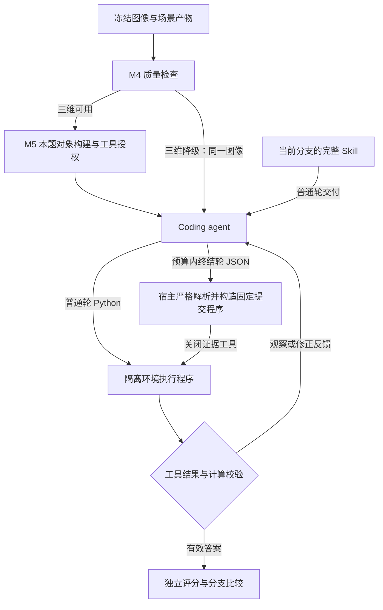

# harness3D 系统架构 v11：Skill 指导的可校验 3D 代码推理

> 版本：v11 工程边界修订版｜日期：2026-10-26｜修改基线：`main@88e8e1303aead063b74f4d916a6cd08c73a2c49c`
> 性质：当前实现以本文件所在 Git 提交为准；本次修订见 §8.2，研究主张与模型效果须以独立运行证据为准。
> 当前主线：Qwen3.8-Flash 解析题目及在线求解；M5 全冻结帧检测、逐帧 SAM2、分组选择审核视图，默认 Intern-Decision 类别审核；统一代码求解、预算内 JSON 终结与独立评测视觉补答。
> 状态口径：§7 集中列出当前合同身份；§8 区分代码实现、工程验证和历史实测。独立服务器验证目录不代表现有任务已部署新版本。

本文的源码路径与默认行为包含本次工程修订；其他工作目录可能仍检出较早开发分支。
更新本文件不会切换该目录的分支、同步其余源码或部署服务器。仓库参考文档链接固定到
核对提交，便于在保留旧 worktree 时查阅相同版本。

## 1. 研究目标与范围

系统围绕两项待实验验证的核心主张展开，并将工具质量校验作为两臂共同固定启用的基础条件：

| 定位 | 系统实现 | 本版处理 |
|---|---|---|
| **待验证主张 1：类沙箱机制下的 Skill→代码对比实验** | 同一个 coding agent 在隔离执行分支中分别接受无 Skill 或冻结 Skill，生成并执行代码 | Skill 是否改善程序行为与答案？改进是否来自方法内容？ |
| **固定基础条件：对工具使用进行校验** | 检查重建质量、工具前置证据及返回结果，在程序使用前授权、使用后核验 | 本版固定开启，不设置关闭臂；实现与验收通过不等于门限已校准或下游收益已验证 |
| **待验证主张 2：将 Skill 指导生成代码引入 3D 推理** | 将对象关联、坐标、距离、方向与尺度规则写成方法，指导代码组合感知和几何工具 | 领域方法是否改善空间计算与证据使用，而不仅是改变回答措辞？ |

这里的 coding agent 是“读取题目、图像、方法和工具接口后生成程序的在线 agent”，当前固定为百炼 Qwen3.8-Flash。Skill 演化负责提供可比较的新方法，是支撑流程；主贡献不以两代晋升次数或治理模块数量定义。

原 Skill-3D 已有场景相关方法和工具使用策略。[R3] 因此第二项待验证主张应表述为“将 Skill 指导的代码生成与执行用于可校验的 3D 推理”，不能仅以“Skill 用于 3D”宣称首次；区别应落在程序执行、固定工具校验及受控实验结果上。

保留八类 S0 方法。计数继续作为工程冒烟与既有演化回归；核心实验至少增加一个已有的几何题型切片，优先 `object_rel_distance / S03`，避免只凭计数结果声称验证了 3D 计算。先做冻结 S0 的核心对比，再按需运行单题型两轮修订；独立泛化在方案冻结后验证。

## 2. 相对 v10 的删减

下列为 v11 的设计选择，替代 v10 对应要求；不是对历史运行的重新解释。

| v10／历史机制 | v11 主线 |
|---|---|
| 每谱系两个在线版本竞争、模型单独选择版本、第三版历史化 | 每谱系一个活跃版本；发布时替换指针，旧版本只供对照与回滚 |
| top-k、向量排序、reranker、独立选择请求 | 按规范题型＋初始证据状态查找唯一活跃方法；没有方法就以公共求解合同运行 |
| `program_synth_v8`、早期 v11 提示词及对应执行分支并存 | 当前普通求解、预算内终结及工具合同使用 §7 的固定身份；历史复现使用对应 Git 提交 |
| 13 个演化状态和多类独立收据 | 演化作为辅助的四阶段流程；核心先跑质量门固定开启的 Skill on/off 受控对比 |
| L1/L2/L3、反例搜索、分支优化、独立模型审查等旧治理链 | 不进入本轮主流程；直接评测一个完整候选 |
| 双 seed 作为所有入口的固定准入门 | 普通开发／生产 stream 按各自冻结配置运行；fit-set 默认以 137／138 做父／候选准入，两个 seed 都须通过 |
| 仅工具名交叠／自声明支持的轨迹可学习 | 已交付且身份完整的 learning 轨迹可学习；使用线索只作诊断 |
| 每个 Skill 固定 11 个章节及大段相同执行合同 | 精简方法正文；公共约束由框架统一注入；空章节删除 |
| Memory 数据库、成熟度阶梯、复杂成本门、额外平台建设 | 不作为核心实验前置条件；沿用必要缓存，成本只报告 |

这里的“删除”对运行代码是字面含义：核对基线不保留历史提示词、工具文档、旧
M8–M11 编排或旧 Skill 快照的在线兼容分支。冻结 M5 绑定另有 §6.3 所述的显式、
精确源码差异复用入口，不开放旧求解协议。历史实验结果、trace 和不可变快照可以作为只读证据
保存；通用历史复现仍使用对应 Git 提交。测试只保留仍约束
当前合同的部分，不因文件名带 v9/v10 就机械删除。单活跃版本取消的是线上竞争，父／候选
的离线比较仍保留。单 seed 开发与双 seed 准入的适用入口见 §6；两者均不构成统计显著性证明。

## 3. 最小系统结构

| 模块 | 输入与输出 | 复用位置 |
|---|---|---|
| 3D 方法库 | 题型、初始证据状态与快照 → 一条完整 Skill | `skills/`、`routing/` |
| M5 对象构建 | Qwen3.8 解析 → 全冻结帧检测 → 逐帧 SAM2 → 分组审核 → 本题对象；默认只审核类别 | `segmentation/`、`infra/m5_identity.py` |
| Coding agent 与执行环境 | 图像、方法、工具接口 → 普通轮 Python／终结轮 JSON → 验收、轨迹、答案 | `online/runner.py`、`synthesis/`、`sandbox/` |
| 工具校验层 | 场景产物、调用参数与结果 → 可用性、违规和修正反馈 | `reconstruction_gate/`、`tools/contract.py`、`verifier/` |
| 实验驱动器 | Skill 消融、父／候选准入或系统／Direct Qwen 对比；可选修订与发布 | `evaluation/skill_ablation_v11.py`、`evaluation/fitset_v11.py`、`evolution/`、`governance/` |
| 输入与运行工程 | FullQA 预计算、审计发布与固定快照；可选 episode 进程池及共享请求额度 | `cluster/`、`evaluation/episode_pool_v11.py`、`synthesis/request_governor.py`、`scripts/fullqa_*.py` |



在线共用一条有界求解循环：冻结输入与快照；执行或复用 M4 与本题 M5 前置；按题型加载方法；
同一个 Qwen3.8-Flash 看图求解。普通轮输出 Python，执行工具，必要时把观察送回下一轮；
终结轮使用下述严格 JSON 提交边界。所有 `C1_tools_program` 入口使用 §7 的固定合同，
不能由 YAML／CLI 任意选择提示词或执行协议版本。普通轮 `ReturnAnswer` 只暂存本轮提交，
M11 使用当前轮及历史未失效结果做确定性验收；通过后才独立评分，失败则撤销受影响结果、
清空暂存答案并把结构化原因反馈给同一个 Qwen3.8-Flash。沿用当前求解轮数及有限重试配置，
不再增加选择轮、审查轮或专门的修复 agent。

工具返回统一封装为 `result_id / source_tool / status / data / schema_version / evidence_version`；
`status=ok` 只表示调用成功，仍须检查 `data` 内的缺项、歧义和降级。`ReadObservation`
是宿主分页读取接口，不是新增几何工具；每轮最多读 3 次，每页最多 32 项、4000 字符，
不重跑原工具，随后由 `YieldObservations` 交付有效页面。普通程序完成证据调用但没有控制动作时，
宿主可回传本轮成功且有效的观察；不会把 print、变量或历史结果自动解释为答案。
按新观察、真实交付图像及候选／能力变化记录进展，连续 2 次符合计数条件且没有新进展时
要求终结；显式暂时服务故障不累加该计数。这是冻结试运行策略，不是已标定最优阈值。

预算内终结轮仍由同一个 Qwen 求解，输出一个 `action=answer` 的严格 JSON，
包含 `value / basis / used_result_ids / derivation`，可选 `unit` 必须符合题型。
宿主通过 `parse_finalization` 构造 `AnswerPayload`，再由 `finalization_program` 将已校验
数据编码为固定的 `ReturnAnswer(AnswerPayload(...))` 提交程序，经原 M10 执行与 M11 验收。
模型响应仅按 JSON 数据解析；该轮关闭证据工具及 `YieldObservations`，
不增加原求解请求预算。该轮显式省略完整 Skill 正文，保存省略原因；
普通求解轮仍按既有规则完整交付冻结方法。因此完整交付的验收须按请求阶段判断。

模型公开目录为 13 个工具，四个观察接口对全部题型开放；质心和重投影只向
计数、绝对距离、尺寸、房间面积、相对方向、路线六类题型开放。出现顺序只保留公共观察接口，
相对距离只保留公共观察接口与 `relative_distance_rank`；每题最多展示 4–8 个，详见 §3.2。
两个对象表面距离接口合并为 `object_surface_distance(obj_a, obj_b, unit)`，
米制模式按实际参数追加尺度依赖并检查题级授权；归一化模式不输出米制值。
提示词与调用共用题型规则，历史六个入口仅保留内部兼容。M11、恢复依赖撤销和
计算重放均读取实际单位；Skill 仍由初始状态选定并固定整题。

独立视觉补答是求解循环结束后的评测增量层，与预算内 JSON 终结是两个阶段。只有 `inner_validation`、
`outer_holdout` 或显式授权的 `final_test` 在完整求解与原终结轮之后仍为
`run_error`，才预算外发出一次 `eval-visual-v1` 请求；`induction` 永不启用。
该请求不延续模型消息历史，只包含同一冻结 FrameSet 的 32 张原帧、query、选项和必要的
字母／数值答案模板，不携带 Skill、场景摘要、工具结果、程序、失败反馈、裁剪图或标准
答案。框架关闭该请求的 SDK 隐式重试，严格解析一个字母或一个有限非负数；非法输出和
服务失败不再重试。正常提交即使评分错误也不触发，因此触发判定不读取 GT。成功补答记为
`visual_estimate`／`direct_vlm_routed`，同时保留原 `terminal_failure`、程序轮次、
工具审计及补答前得分快照。B01、B11 与 E11 两臂使用同一开关和请求合同。

**M5 当前默认路径**：问题对象解析 → GroundingDINO 全帧检测 → 逐帧 SAM2 →
mask 结构预检 → 临时几何分组与审核视图选择 → Intern-Decision 类别审核 →
通过候选的正式点云绑定、实例合并与最终验证 → 本题工具。仅构建本题对象，取消通用清单前置；
全场重建不等于全场物体识别或逐一审核。独立百炼 Qwen3.8-Flash 读取
`question / question_type / options`，严格 JSON 示例：
`{"objects":[{"category":"cup","role":"target","source_text":"cup"}]}`。
只提取有题面或选项依据的物理对象、路线地标，排除方向、动作、单位、视频、机器人；
类别用常见英文单数名，source_text 必须原文命中，去重但保留不同角色。最多 16 条；
温度 0、请求级 seed，保存模型／prompt 版本、请求哈希与原始响应。校验失败至多一次
确定性格式修复，仍失败则解析不可用，不以词表补造对象；在线请求不读答案、评分或 GT 3D。
角色：计数／尺寸／出现顺序为 `target`；绝对距离为 `target_a / target_b`；相对方向为
`observer_anchor / facing_anchor / target`；相对距离为 `reference / candidate`；
路线为 `start_anchor / facing_anchor / waypoint / destination`；房间面积无需对象解析。
全部解析类别扫描所有可读冻结帧（正常 32 帧）：每帧优先使用一次多类别检测请求，
无法把服务标签明确分配给解析类别时，该帧逐类别重扫，不猜测标签归属。
帧不足时保留输入降级；不设部分扫描模式，
不因已有同类或发现候选跳过／提前结束，不只探测第 0／16 帧，不改变或重采样冻结帧。
`OBJECT_VOCABULARY`、`SYNONYMS` 不决定扫描对象，也不作为模型失败的猜测兜底。
每帧同类可作确定性 NMS，保留原框、分数、帧索引及请求收据；检测器超时、连接失败、
429、5xx 的有限重试独立记账，最终故障不以 VLM 框或伪候选补位。
NMS 后每帧只执行一次 SAM2 image encoder，各框独立分割，不做时序传播。
结构预检后以有限深度点临时反投影、complete-link 分组，仅用于安排审核；每组确定性选择
至多两视图，优先高检测分数，再选择时间上较远的视图。分组失败则逐观察处理；
`obj_appearance_order` 保留全部观察审核，避免选帧改变出现顺序。
未选中的重复观察标记为 `unreviewed_repeated_observation`，其 mask 不自动进入最终绑定。
全帧扫描、审核请求数与最终绑定支撑帧数是三个不同统计口径。

`configs/config.yaml` 默认使用 Intern-Decision binary／P1、`yes_threshold=0.77`、
`admission_policy=category-only`，审核目标类别及同一候选的完整帧、原 crop、mask crop。
有效收据中的 `p_yes` 达阈值才确认类别；低于阈值记 `uncertain` 并阻塞相关候选覆盖，
不解释为确定错类或物体不存在。类别关系由 binary 收据确定性生成，不另发 Qwen 关系请求。
该默认策略的质量观察为空，不产生模型对可见性、mask 纯度或完整度的结论；非空 mask、
框内支撑、有效深度及数组／字段一致性检查继续执行，不能据此宣称语义纯净。

**可选 Qwen 审核路径**：显式将 `online_model.mask_review` 设为 `null`，同一分组选择流程
改用 Qwen3.8-Flash 目标盲审。候选图不带目标类别文字，先冻结 `observed_object`、
可见性、纯净度和完整性，再用独立纯文本请求比较题目类别；仅类别关系与质量条件都满足才准入。
这条路径已实现但不是当前默认；不得把它的质量条件写成 category-only 已完成的质量评估。
其他带冻结质量收据的审核选项须按其真实配置及身份单独记录。

审核准入后生成正式局部点云，实例关联使用同帧互斥、世界质心、局部 bbox 和 complete-link；
接近但未合并的同类别实例保留 `duplicate_suspect`，最终校验关闭其几何。
该标记既可能涉及同物重复、部件与整体，也可能涉及真实邻近实例；当前实现没有逐例判别并豁免。

多实例参照不静默取首项。
相对距离工具保留逐实例测量与降级标记，缺候选、不可测实例、身份冲突或最小值并列时
不给最近类别。M11 与 derivation 共用排名合同，并按本题实际选项核对覆盖与映射。
接近但不相等的距离仅记录 margin，尚未标定近似并列阈值。后续纯视觉零工具提交仍可
舍弃历史几何；局部排名失败不撤销整个场景的几何前提。检测器只对超时、连接失败、
429 和 5xx 作有限重试，重试尝试与最终未恢复故障分别记账。
本次不修改冻结 Skill；两臂使用相同 M5 结果，不能将 M5 变化解释为 Skill 收益。

M4 重建主门通过只说明跨视图几何达到冻结阈值，不证明对象类别与 mask 绑定正确。
候选、track、类别、角色保留身份映射；mask 用深度／内参／c2w 反投影到世界系。
最小验证：mask 非空且有正有限深度点；visible_frames 与保存 mask 严格一致；有限非空
点云与提供的逐点置信度同序同长；质心／bbox 从保存点云重算，去重后全部字段同源。
明确不相容标签的 mask 在至少两个共同非空帧堆叠 IoU ≥0.95 时硬拦。检测分数、
帧支撑率及 depth_conf 不认证语义；存疑框／mask／track 不算通过，计数保留全部可用实例。
解析、检测、SAM2、绑定或验证失败关闭相关对象几何，不等于不存在；可继续冻结图像
二维求解，失败、降级、无答案保留评分分母。

授权的房间题在两臂求解前以独立子进程共享预计算一次 `plane_fit_room_size`，300 秒
上限；成功 payload 或失败／超时状态都随 frozen tree 固化。收据绑定 point-map
SHA-256、米制尺度、原语参数、实现源码、冻结输入身份和 payload，运行时只允许验证后
读取，身份不符时禁止臂内重算。`fit_quality` 使用
`sqrt(floor_fit_ratio * ground_planarity)`；`plane_inlier_ratio` 仍表示地面内点占
全部点的比例。`plane_fit_low_quality` 尚未标定，只作审计。共享预计算是 B01/B11
共同基础设施，不是 Skill 产出，也不得计作 B11 收益。

对象、结果、调用与共享前提继续按已有规则区分失败范围。
`FailureCause` 的局部对象原因只撤销消费该对象的结果；未受影响对象与共享尺度继续有效。
共享深度、位姿或米制尺度确实失效时才按对应前提级联。NameError/UnboundLocalError
使用同 AST×同证据的执行前重复保护。观察摘要先保存候选身份与 flags，再补质量字段；
完整审计内容保存在结果和轨迹。

答案解析、M11提交与独立评分分别记状态。空GT的已解析预测保留，score/correct/MRA
为空；不得用假零分判断合法性。M11执行状态及最终引用质量由真实执行和结果依赖链汇总。
现有扩大面板和暂停实验保留原输入、版本与记录，不自动恢复；新 M5 结果
另建基线，不写入旧冻结树。完成答案冻结后仍由独立进程评分。

M5 缓存采用“对象解析＋本题绑定”：角色对应清楚，但跨题可能重复检测；通用场景＋类别
复用暂未作为主路径。另有同题、相同帧与几何身份下的生成结果复用，用于 prepared 迁移及
FullQA base／metric，须证明逻辑身份和源字节一致，见 §6.3。身份绑定帧及顺序、问题／选项／题型、
重建、GroundingDINO／SAM2、解析与审核模型、prompt／seed、参数、环境与源码；按模块升级身份，
缺身份不复用，旧产物只读。准备为 M4 → M5 → 本题 SceneState／SceneHandle、证据和权限；
G7/G9 只诊断，统计用本题分母。paired preparation 冻结两臂相同 M5 结果，臂内不重检。
当前生成、解析、绑定、缓存及验收版本集中见 §7；改变审核策略须产生新的配置与缓存身份。
NMS IoU=0.7；同帧实例合并使用 mask IoU≥0.8，跨帧使用世界质心与局部 bbox 的
complete-link 条件，质心尺度容差为深度中位×0.15；候选 mask 至少一半在框内；
数值容差为 1e-6。这些工程参数尚不能解释为独立验证过的检测／关联最优阈值。

下列七条属于正确性条件，不能为简化而删掉：

- 同一 episode 固定输入与快照；成对比较使用相同实际帧集、基础产物和模型配置。
- 有可读图像时继续求解；感知失败只关闭依赖该证据的工具。全部图像不可读则记输入错误，保留评估分母。
- `QuestionState` 继续管理题级绑定、证据与失效；工具文档和执行权限共用同一判定。
- 新图像／工具观察实际交付模型请求且响应完成后才记已观察；失效结果不能继续支持答案。
- 在线求解期间，coding agent、工具和沙箱不读标准答案或 GT 三维标注，评分器独立持有
  标签；离线 Skill 修订阶段可以按 §6 读取 `induction` 的题目级标准答案与评分，但这
  不得改变在线求解的标签隔离。
- 演化期冻结模型、工具、阈值、评分器与求解预算；系统改动另建基线。
- `SkillSpecV11`、公共提示词、工具文档和执行协议作为不可拆分的运行合同校验；任何旧格式或版本错配必须在首次模型请求前失败。

VGGT、可选 MoGe-2、GroundingDINO／SAM2 复用现有模型。研究重点是 coding agent 如何在
Skill 指导下使用工具并校验可靠性；不新增重建主干、训练系统或对象质量平台。

### 3.1 类沙箱执行与核心对比

这里的沙箱首先是**可控的程序执行与分支隔离机制**。每个实验臂使用独立程序命名空间、题级状态、临时输出和结果登记；只共享只读图像、冻结重建与同一份本题 M5 结果，不共享另一臂的答案、程序变量或运行记忆。保持相同代码能力和预算，不要求为本研究建设完整容器安全平台。

Skill 指导的核心消融保留 B01／B11 两臂，所有组均由同一 coding agent 生成代码并执行：

| 实验组 | 方法指导 | 几何质量门 | 比较目的 |
|---|---|---|---|
| B01 | 无 Skill | 固定开启 | 共同 coding-agent 基线 |
| B11 | 冻结 S0 Skill | 固定开启 | 主系统；B11−B01 为 Skill 对程序行为与答案的效果 |

两臂使用完全相同且固定开启的几何质量门、工具前置检查和结果合同；质量指标、授权结果与违规仍进入 trace，但不是本版实验自变量。B01／B11 的唯一方法变量是是否交付冻结 Skill，因此不得从两臂差异推断质量门收益。B00／B10 不进入主实验，也不为本版新增质量门关闭路径。

B01 和 B11 天然使用唯一的当前公共提示词、工具文档与执行协议，不再各自配置模板版本。
普通在线入口、配对入口和发布后运行必须调用同一个 solver；不得为实验入口保留一套
M11 可重入语义、而让普通入口使用另一套旧语义。

后续比较修订方法时，增加 E11：仅把 B11 的父方法替换为候选。无 Skill 对比用于证明方法指导价值；候选准入仍与父方法比较。共享图像、模型、重建、接口、公共提示词和预算，各臂必须独立生成程序。最终系统成绩通过正常方法加载获得，固定注入只是控制实验变量。

当前另有 `scripts/run_direct_qwen_v11.py` 与 `scripts/run_fitset_v11.py` 的系统比较入口：
Direct Qwen 直接读取同一冻结 32 帧和原题，Harness3D 按正常工具／方法路径运行。
该比较衡量整套系统与直答基线，同时改变代码、工具及方法使用；不能把差值作为单独的
Skill 效果，也不能把复用 learning 题集的成绩当作独立泛化。三类比较分别保存输入、
模型、采样、方法交付、补答开关及评分身份，不能混合分母。

若进一步主张“生成程序”优于直接工具规划，再增加一个 T11 参照：使用同一 Skill、工具与校验，但直接输出工具调用，由框架串行执行，不生成自由程序。T11 与 B11 隔离行动表示的差异；它是受控机制对照，不冒充完整复现 Skill-3D。B01／B11 主实验本身不支持“代码优于非代码”的结论。

按题型报告官方 Accuracy／MRA、合法答案率、程序错误率，以及不可信几何被实际使用的次数；补充首次重建、M5 请求与运行成本、生成轮数和工具调用数。独立评分器评答案，校验器判工具与计算合同，不用另一模型当最终正确性裁判。不要以工具调用更多或门通过率更高替代 Skill 带来的答案收益；质量门相关统计只作固定基础设施的诊断。

### 3.2 固定工具校验合同

- **产物质量**：按 2026-10-14 简化版方案，M4 对整场计算 warp 内点率、分组点云重叠率、两重建头相对差 P95 和邻域距离长尾比，四项全部满足才通过；不通过则整场二维降级。新增统计共用全部冻结帧的步长 16、偏移 4 网格，M4 只评估整场，不把 M5 对象验证并入主门、不增加逐点管理。质量版本为 `v7-scene-warp-overlap-head-tail`，旧两项质量可读取但必须用原数组重新计算、另存新版收据；缺失或非有限值不记通过。新增 0.15 / 3.0 为候选阈值，独立场景验证后才能进入新正式实验。模型 confidence 保持既有辅助职责。
- **对象绑定完整性**：按前述 M5 最小验证检查 mask／点云／字段一致性及明确标签冲突，未通过或存疑的对象几何不可用；结构通过不等于语义认证。
- **调用前置条件**：按具体工具检查对象绑定、有效产物、世界系与尺度。相对距离排序不必有米制尺度；米制距离和面积必须有有效尺度，面积按尺度平方换算。paired 房间题只消费共享 prepared receipt。
- **结果与使用**：M11 核查工具授权合同、引用、状态、单位及 derivation 重放，不认证对象语义；服务失败不解释为零或空场景。失效结果撤销后反馈 coding agent，在原预算内修正或视觉作答。

题型目录与运行授权共用 `tools/task_policy.py`；下表是题型允许的上界，实际展示还需满足
当前证据与产物条件。公共观察接口为 `inspect_frames / detect_objects / list_objects /
object_visible_frames`；空间辅助接口为 `object_centroid / reproject`。

| 题型 | 公共观察之外允许的接口 | 接口上限 |
|---|---|---:|
| `object_counting` | 空间辅助、`count_objects` | 7 |
| `object_abs_distance` | 空间辅助、`object_surface_distance` | 7 |
| `object_rel_distance` | `relative_distance_rank` | 5 |
| `object_size_estimation` | 空间辅助、`object_3d_extent` | 7 |
| `room_size_estimation` | 空间辅助、`plane_fit_room_size`、`connectivity_graph` | 8 |
| `object_rel_direction` | 空间辅助、`relative_direction_of` | 7 |
| `obj_appearance_order` | 无 | 4 |
| `route_planning` | 空间辅助、`connectivity_graph`、`relative_direction_of` | 8 |

相对距离题不展示或授权质心、重投影及单对象对距离接口，完整排名必须使用集合合同。
计数／完整排名要求技术候选覆盖；显式对象对工具主要校验所选对象，整题候选不完整时
仍可能得到合法局部测量。类别覆盖通过也不能证明视觉检测找全所有真实实例。

重建一致性并不保证真实几何正确，工具授权也不保证答案正确。本版固定开启几何质量校验，
不新增 B00／B10 关闭臂。主实验前仍须冻结阈值、版本和配置身份；源码中仍标为
`TODO_CALIBRATE` 的默认值不能冒充已校准正式门限。既有退化案例只作为回归检查，
不计作本版核心实验贡献；当前 M4 拦截比例、对象绑定质量和下游答题效果须分别验证。
不开新的指标平台，不恢复已退役的 BA／GT 标定支路。

## 4. Skill 格式核查结论

本节对照 Codex／Agent Skills 官方规范，以及 Skill-3D 官方公开介绍和核查时的 `legacy/skill3d/core/` 副本。下表的具体字段与导出行为来自该历史副本（已保存在 Git 中），不声称已核对上游最新实现。

| 维度 | Coding agent Skill | 原 Skill-3D | 当前 harness3D |
|---|---|---|---|
| 核心表示 | `name`、`description` 与 Markdown 正文 | 种子对象为 `name / when / strategy / tool_usage` | 完整 `SKILL.md` 加框架身份 `SkillSpecV11` |
| 方法内容 | 步骤、条件、例子；资源可选 | 动态方法还含触发条件、回退、停止条件和失败记忆 | frontmatter 摘要与自由 Markdown 方法正文 |
| 加载方式 | 先发现摘要，选中后读完整方法 | 有方法卡片与 SKILL.md／references 导出 | 按规范题型＋初始证据状态读取唯一 active 的 `source_ref`，普通轮完整交付 |
| 必需代码 | 不要求，可纯指令 | strategy 可以是自然语言 | 不必变成可执行函数或固定调用图 |

官方格式允许字符串映射 `metadata`，正文不要求固定标题。已检查八条 S0 的名称、目录、描述长度及 metadata 类型，均符合这些格式要求；11 个固定章节是项目自加限制。格式兼容不等于工具接口可跨框架执行。[R1][R2]

v10 转换链曾确认下列根因；它们用于解释为什么 v11 不继续兼容旧运行对象，不是当前
`SkillSpecV11` 的字段定义：

1. **方法内容丢失。** 旧 `source_compiler.py` 解析“代码示例”和“失败教训”，却不把它们写入 SkillSpec；v11 改为直接加载和交付完整 `skill_md`，不再重编正文。
2. **description 职责混杂。** 旧编译器把目标、公共约束、检查和局限拼入 description；v11 只把短摘要留在 frontmatter，共享执行合同由框架统一注入。
3. **正文与候选存在两条编辑路径。** v10 离线链直接生成并内联 JSON SkillSpec；v11 规定候选和发布产物都必须是完整不可变 `SKILL.md`。当前在线方法库、v11 演化编排、真实 trace collector、离线修订器和 E11 执行适配均已迁移；是否有效仍须由真实 GPU 运行收据回答。
4. **旧字段缺少独立语义。** `call_graph_template` 和固定 `supported_coordinate_frames=["world"]` 不再属于 v11 运行对象；坐标、证据和权限由 ToolSpec 与题级状态负责。

保留原 Skill-3D 的“触发—策略—工具条件—回退／教训”思想，采用 coding agent 的简短入口与完整正文。不要照搬其全部记忆统计或工具链；这些实现各自服务不同实验。[R3][R4]

## 5. v11 的统一 Skill 合同

### 5.1 唯一方法源

每个版本保存一个不可变 `SKILL.md`。YAML 必需字段只有 `name`、`description`：name 为不超过 64 字符的小写字母／数字／连字符名称，与目录同名，禁止首尾或连续连字符；description 非空、不超过 1024 字符，说明用途与触发条件。正文自由 Markdown，建议包含方法、重要分支与检查；示例、教训有内容才写，不重复全局权限与执行规定。

以下是格式示意，不是已从真实轨迹学得或已发布的新版本：

````markdown
---
name: rank-object-distances
description: 比较题面参照对象与候选对象的空间距离并选择最近项；处理多实例、遮挡和候选覆盖不足，不要求米制尺度。
---

# 对象间相对距离推理

## 方法
1. 从题面取得参照对象、候选类别和原始选项映射；不要把参照对象替换为相机。
2. 解析参照实例与各类别候选实例。将漏检或歧义记为未知，不当作无限距离。
3. 几何工具获准时取得对象间距离，检查其坐标、距离定义与点集有效性；同一类别按题意取最近实例。
4. 用一致定义的归一化距离排序，无须为相对排序补造米制尺度。不要用相机 z 深度或图像二维间隔替代对象间距离。
5. 核查会改变前两名的错误绑定、遮挡和覆盖缺口；必要时请求相关冻结帧的观察，再映射回合法选项。

## 分支与检查
- 几何被禁用时，根据原图的共享结构、深度线索和遮挡关系比较局部布局，标记为视觉或混合依据。
- 明确工具给的是表面距离、稳健近似还是质心距离，不能混用后声称精确最近点。
- 提交前检查参照身份、各候选覆盖、计算定义与选项映射，引用实际使用的有效结果。
````

正文没有必须使用工具的要求，但需写出能指导代码决策的领域规则：距离方法区分参照与度量，方向方法定义 observer／facing／target 和水平坐标，尺寸／面积方法明确尺度与单位。Skill 负责说明何时、为何及怎样组合计算，具体 API 由当前工具文档提供；框架负责执行校验。代码示例如存在，需匹配实际接口；伪代码明确标记。首期不随 Skill 演化新增脚本，以保持工具体系冻结。

### 5.2 方法内容与运行身份分开

身份留在方法库索引／候选记录中，首期最小条目为：

```json
{
  "skill_id": "S03-g1m0",
  "version": "1.0.0",
  "question_type": "object_rel_distance",
  "evidence_state": "g1m0",
  "source_ref": "versions/S03-g1m0/1.0.0/rank-object-distances-g1m0/SKILL.md",
  "content_sha256": "<完整规范化源文件的摘要>"
}
```

同一方法保持稳定 `name` 与 `skill_id`。版本、父版本、候选 ID、来源 run 和评测结果由框架维护，不让离线模型自行编造。一次发布后该版本不可覆盖；被拒绝的尝试按 candidate ID 保存，可以再次提出同一目标版本。

`question_type + evidence_state` 在索引中精确选择；工具权限、证据阈值与坐标要求归 ToolSpec；分数、label_access 和 provenance 归实验记录。状态由初始两项公共证据派生，不能从题型米制门是否通过推测。

### 5.3 无损编译与交付

最小运行对象为 `SkillSpecV11(skill_id, version, question_type, evidence_state, skill_md)`；`name / description / body` 由同一个解析器只读派生。JSON 可以作为缓存或传输封装，但不能成为另一份独立手写源。

- 统一 UTF-8、LF 换行与文件末尾一个换行后冻结源文本；之后不改写正文段落或顺序。
- 加载时检查身份、hash、frontmatter 和服务长度，普通求解轮完整注入 `skill_md`；终结轮按 §3 显式省略。版本标识可放在块外，不改块内内容。
- 同一字符串用于模型请求与 `content_sha256`。示例、教训、条件、检查均不得被编译器静默丢弃。
- 超出上下文预算时静态拒绝候选并要求压缩；不截断后声称完整交付。
- 首期无独立 Skill 选择请求。若将来有多个方法，再采用“短摘要选择→完整正文”；附加资源也需先实现真实读取与交付记录，不能只给无法读取的路径。

当前在线运行只接受 `SkillSpecV11` 与 `runtime-skill-snapshot/3.0`。旧 SkillSpec、旧快照
Schema 和旧正文编译器不进入在线 loader，也不提供运行时自动转换。历史源、快照和 trace
可以只读归档；需要重放时使用对应 Git 提交。

迁移口径为：短 description 回到 YAML；`call_graph_template` 的方法步骤与
`validation_assertions` 的有效检查合入正文且去重；示例／教训保留；共享执行约束移到
唯一公共提示词；旧证据／坐标字段由工具合同承接。新格式建立单独基线，不能把格式迁移
造成的分数变化计为演化收益。

## 6. 支撑实验的简洁 Skill 更新

### 6.1 槽位、生产 stream 与共同修订合同

公共证据只保留 `geometry_3d` 与 `metric_scale` 两项 `available/unavailable` 状态。
几何可用由现有 M4 门决定，尺度可用由融合／自洽门前五项决定，题型授权单独计算；
几何失效连带尺度，尺度失效不影响非米制几何。软告警只进入诊断，不独立分组。
固定数据图片和统一采样帧作为输入前提；检测、类别审核、mask／点云技术校验、
去重诊断和工具局部世界坐标约定检查保留，但不进入公共证据签名。
M5 只能提供候选，不能认证同类实例中哪个是题目指代。在线模型查看帧／裁剪并选择
明确 `obj_id`，唯一候选不等于指代正确；M11 只验证技术事实与计算，不认证指代真伪。
单对象调用只验证所选对象，计数／完整排名验证所需集合覆盖，局部失败不全局降级。
二维候选查看独立于三维可用性；工具展示与执行来自同一授权判定。
每题型分别保留 `g0m0`（无几何／无尺度）、`g1m0`（有几何／无尺度）、
`g1m1`（有几何／有尺度）三个槽位，active seed 保存 24 个活跃槽位；`g0m1` 非法。
当前默认快照为 `mixed-r04-20261026-v1`，仅采用 r04 中通过双 seed 诊断准入的
`S04-g1m0@1.1.0` 与 `S05-g0m0@1.1.0`；其他 22 个活跃槽位保持
`S0-v11-task-tools` Parent。快照和 manifest 的 `entries` 总数为 28，
包含四条历史版本；不能把总索引条目数、活跃槽位数和可达槽位数混用。
该混合库按用户选择建立，来源与逐槽位处置见
`skill_library/validation/mixed_r04_20261026.json`；混合方法的整体效果尚未运行。
显式冻结 S0 的既有 B01/B11 与 outer baseline 仍使用各自登记的原快照。
当前 fit-set panel／调度只允许 19 个可达槽位：8 个 g0m0、8 个 g1m0，以及绝对距离、
物体尺寸、房间面积三个米制题型的 g1m1。5 个非米制 g1m1 保持原 seed 内容和版本，
不进入该入口的运行、修订或 A/B；物理条目数不能当成实际演化槽位数。
`active_by_slot[question_type][evidence_state]` 每槽位只保留一个活跃版本。
M7.5 后、首次检索前冻结初始状态，精确选择一条完整 Skill，整题固定版本和正文 hash。
运行中共享证据仍可撤销、工具仍按当前事实收回，但不重检索 Skill；局部对象与坐标
故障也不改变槽位。每条方法保留必要的失败处理。缺画像不等于 g0m0，缺槽位不借用
另一状态的方法。

核心 B01／B11 不等待演化。持续演进以
`question_type + initial evidence_state + delivered parent version` 为 buffer 键；
每新增 12 条合格 induction 轨迹触发一次候选。答错、程序错误、工具合同拒绝和证据
降级都是可学习失败；输入不可读、服务不可用、trace 不完整、父版本／hash 不一致等
运行故障单独落 `operational_failure`，不计入 12 条。拒绝后父版本和累计经验不变，
必须再新增 12 条才重试；晋升后原子切换 active，新版本重新计数，发布后正常 learning
直接成为新 buffer 的首批经验。生产 stream 的 `--flush-tail` 默认开启：整轮结束时，
从未触发过候选且至少有一条经验的槽位执行一次尾批次；已尝试槽位的零散余量留到下一轮。
fit-set 不执行不足 12 条的尾批修订，见 §6.2。

生产 stream 调度入口为 `scripts/run_streaming_evolution_v11.py`。它在模型请求前按共享重建
产物计算初始状态，为每个目标槽位冻结至少 8 条且与 induction 场景隔离的
`inner_validation` 配对面板；随后每题重新加载 active、冻结父快照、运行独立 trace
并入 buffer。`run_gpu_experiment_v11.py` 在 `run_evolution=true` 时直接进入该入口，
不再先跑整批 parent learning 或单槽位一次性 campaign。计划、trace、buffer、
campaign 收据和发布后 learning 均可独立恢复；已记录 deferred 的槽位必须显式重试。

修订与发布的运行对象固定为
`SkillCandidateV11 → 完整 SKILL.md → runtime-skill-snapshot/3.0 → publish_v11_candidate`。
不得再生成 JSON SkillSpec、内联 `call_graph_template`、保留多个在线竞争版本，或调用
v10 的 `publish_candidate_snapshot`。生产 stream 使用 `evolution/campaign_v11.py`；
fit-set 使用 `evolution/fitset_stream_v11.py` 与 `evolution/fitset_revision_v11.py`，
复用完整方法源、canonical 案例和发布合同。旧 campaign、旧发布器及旧 SkillSpec
不进入当前在线链，历史复现使用对应 Git 提交。

| 阶段 | 最小行为 |
|---|---|
| 采集 | 父快照正常运行 learning，关联问题文本、选项、实际交付正文、模型答案、题目级标准答案、评分、各轮原始程序、结果与图像来源；同时保留成功和失败案例 |
| 诊断（可选） | 按冻结预算确定性选择成功、失败和部分得分案例；区分观察、原因假设、替代解释和未知项，引用原始证据与绑定父正文 hash 的标题位置；不执行工具、不评分、不决定晋升 |
| 修订 | 给离线模型父 SKILL.md、完整 `induction` 案例和接口合同；启用诊断时额外交付诊断和原始来源片段，返回 `revise` 或正常的 `no_change`；框架生成候选身份、hash 和 diff |
| 评测 | 冻结同题型、同初始状态的独立面板，父／候选完整注入；同输入与预算独立执行，核对配置／协议／实际交付身份、完整分母与最少配对数；fit-set 默认隔离要求见 §6.2 |
| 发布 | 得分严格提高、运行错误不增加、合法答案率不降、两臂不可信几何使用均为零，且配对／交付身份有效时只替换目标槽位；程序错误只作诊断统计 |

经验必须含问题文本与选项、模型实际答案、题目级标准答案（reference answer／答案 GT）、
首次两项证据状态及能力／候选变化、候选对象、实际解析使用的对象 ID、图像观察记录、
评分、关键代码、工具状态与观察、错误类别或误差方向，不能只给调用计数与 MRA 均值；
整题归属于初始槽位与实际交付父版本，不按最终状态改归属，同题型其他状态不混入；
答错不自动归因为对象绑定／指代选择错误。当前经验包版本为 `skill-experience-bundle-v11/6.0`，
新增 `rounds`、`image_refs` 与 `frame_set_hash`。原始轮次保留程序、调用参数与结果、
观察／使用／撤销记录；来源链接指向真实轮次，不用最终程序补造缺失的中间动作。
缺少原始字段、未解析结果或无法归属的图片仍记为未知。5.0 包可读，但不作为新修订的
可写运行输入。
纯视觉路径也可学习，工具名交叠不能证明因果使用。保留 MRA 原始含义，不将缺少布尔
正确率当作全错。完整经验包直接作为离线修订输入，不另建删除问题文本的匿名 revision
对象；run／qa／scene 身份与 trace 引用保留为 provenance。读取 `induction` 标准答案或
任何由其派生的正确性、分数和误差反馈时必须记 `label_access=true`。该权限只属于
`induction` 的离线 Skill 修订：`inner_validation`、`outer_holdout`、`final_test` 的
逐题标准答案与反馈不得进入修订输入，GT 深度、位姿、三维框等三维标注也不因开放题目级
答案而开放。

### 6.2 fit-set 入口、标签范围与诊断

`scripts/run_fitset_v11.py run-system --phase accumulation` 提供另一条学习入口，
CLI 默认 `full_cases_v1 + scene_disjoint + batch_v1`，调度器默认 `slot_shards`。
底层 `FitSetEvolutionConfig` 为兼容历史调用仍默认
`aggregate_v1 + same_question + novel_failure_v1`；直接实例化配置类的调用不能被描述为已经采用 CLI 新默认。
生产 stream 保持完整案例直接修订，诊断模式显式选择 `off/text/multimodal`；
fit-set 的四种输入模式为统计、完整文本案例、文本诊断与多模态诊断。
完整案例及诊断只接收 induction，保留真实 `source_split` 和显式学习角色，
不能把旧 inner 轨迹改名为 learning。

| 行为 | 生产 stream | fit-set CLI 当前默认 |
|---|---|---|
| 入口 | `run_streaming_evolution_v11.py`；GPU launcher 的 `run_evolution=true` 仍进入此处 | `run_fitset_v11.py run-system`，显式选择 accumulation |
| 经验触发 | 每新增 12 条；默认对从未尝试槽位做一次尾批次 | 每新增 12 条；不足 12 条不做尾批修订 |
| 学习输入 | 完整 induction 案例；诊断 off／text／multimodal | 完整 induction 案例；诊断通过 learning-input-mode 选择 |
| 准入面板 | 每槽位至少 8 条、与 learning 场景隔离的 inner；按冻结配置执行 | 显式独立 gate 清单，每槽位至少 8 个不同场景，与全部 learning 场景隔离 |
| 求解／gate seed | 默认运行配置为 0，可显式冻结其他 seed | `--seed` 默认 137；gate 实际运行该 seed 与 seed+1，即默认 137／138 |
| 并发 | 使用该入口自身的冻结调度合同 | 默认 slot_shards；可选 episode_pool，owner 与 executor 分开 |

fit-set 在任何模型请求前校验完整 gate 输入、绑定和场景覆盖，不能以缩小 learning
任务数绕过 gate 预检。gate 可以取独立留出的 induction 或 inner_validation 场景，
其逐题标签与反馈均只归独立评分／准入，不能进入学习调度、buffer 或下一次诊断。
默认两个 seed 分别独立执行 parent/candidate；每个 seed 都须得分严格提高、运行与程序
错误不增、合法率不降、无不可信几何使用或服务错误，并证明实际方法交付／hash、
请求 seed、共享输入、返回模型及可观测后端身份相符。sealed M5 seed 保持原身份，
不随 gate solver seed 重算绑定。历史 `same_question` 只作同题拟合探索，不能支持独立泛化。
完整案例模式不因聚合统计签名相同跳过不同经验。

诊断不取代原始经验。默认上限为 4 个案例、64000 个诊断输入字符、8 张图片、
4096 个输出 token，均为工程预算，不是已验证的最佳配置；运行前冻结，超限案例整体
不选并记录原因，不静默截断。文本中的路径或 image ledger 不表示诊断模型看过图像。
多模态模式通过显式图像 provider 交付并核验真实字节；fit-set 使用单独保存并绑定
结果 hash 的冻结 32 帧 PNG。优先有记录的观察视图，随后覆盖冻结帧范围并跨案例
分配预算；在线未观察的冻结帧只能解释为额外离线视觉证据，不能补写在线观察事实。
少数视图不证明场景完整覆盖，供应失败或 hash 改变必须停止该诊断。
生产多模态入口要求调用方显式注入 provider；默认离线模型是否支持图像和方法质量
仍须真实服务验证。

修订响应声明 `action=revise/no_change` 与修改理由。`revise` 提交完整正文、单一
`change_hypothesis`、实际变更的 `changed_sections`、预期过程变化和证据引用；
框架核对声明与实际段落差异。`no_change` 不生成候选、运行 gate 或切换 parent。
静态检查包括格式、名称／题型一致、有效内容变化、接口存在、候选正文无具体样本身份
或答案泄漏、框架配置不变和完整交付；还按共享执行合同检查确定性冲突、代码示例编译、
工具参数及响应结构。它不能证明任意自然语言算法正确，也不能替代性能 gate。
离线修订模型可以读取 induction 标准答案，但不能
把某题答案或 ID 写进通用 SKILL.md。输入权限校验与发布内容泄漏扫描分别执行；
最终方法仍拒绝样本身份与题目／长选项／参考答案复制。格式错误有限重试，传回上一轮
候选、原始 hash、安全错误码和正文位置；样本泄漏内容按行脱敏，多行复制也不回显。
超出修复上下文预算时停止，不伪称完整交付。`no_change` 保存可恢复决策，不生成候选、
不运行 gate、不改 parent，下一批继续采集。

配置全局 `RequestGovernor` 时，solver、gate、诊断与修订／静态修复共用累计请求预算、
并发 permit 和限速；episode_pool 要求显式配置，slot_shards 保留未配置 governor 的历史调用。
诊断也计入每槽位修订请求上限；token usage 同时支持文本和生产元数据响应。诊断在同一 campaign 只请求一次，
重试修订复用其完整收据。`RequestGovernor` 在请求前持久化额度预留和 `started` 状态，
结束后记录 `completed/error` 与可测 usage；未知完成请求仍占用额度。
fit-set 修订入口另保存不可变 `request_intent` 与交换结果，只有意图而没有完成结果时
拒绝自动重放；请求额度账本与修订收据是两个层次。A/B 逐题反馈不能变成修复或诊断输入。

生产 stream 与默认 scene-disjoint fit-set 的 learning／gate 按 scene 隔离，
历史 same_question 例外按上述探索口径报告；面板与 seed 在运行前冻结。同一槽位
连续候选优先使用互不重叠的 inner 分片；反复使用同一 inner 只能解释为开发选择，
最终泛化必须由未参与晋升的 outer holdout 回答。生产默认 seed 与 fit-set 双 seed
的入口区别见上表；配置必须真实进入模型请求。多个 seed 就逐一执行，不能只改收据标签。

发布保存不可变源与快照，原子切换 active pointer，父快照留作回滚。随后以正常加载方式运行新一批 **learning**，核对新正文与 hash；这批可直接接入下一代，无须独立探针。发布未交付则停止下一代；拒绝也须重新采集。旧 trace 不改名复用，inner 不改名为 learning。

### 6.3 episode 执行池与 FullQA 输入工程

fit-set 的 `episode_pool` 是可选进程调度器，最多 32 个 episode executor；
Skill library owner 单独冻结，默认 4 个，不限制为 4 路在线求解。每题在进程主线程执行，
保留 SIGALRM sandbox、独立 namespace、trace、临时目录及派发时的方法／快照身份。
同一 lineage 的批次可并行执行，结果按冻结顺序入库；修订／发布由协调器串行处理，
完成版本边界后才派发该 lineage 下一批。修订期间暂停新派发、排空在途任务，
gate 可在共享 episode 上限内并行，不能据此声称全程持续占满 32 路。

该调度器要求显式全局请求额度；`RequestGovernor` 以文件锁 permit 与持久化额度预留
约束 solver、诊断、reviser、gate 的累计调用、并发及启动频率。额度耗尽属于运行取消，
不作为方法失败或准入拒绝。未知完成状态仍占用额度，不能自动重放。
恢复必须保持输入、源码、scheduler、workers、owner 数及请求策略一致；
乱序结果在前序完成后按冻结顺序去重入库。日志只保存安全身份和可测 token usage。
executor 不接收标签 metadata；已发布输入 provider 返回空 GT，评分／离线修订的权限
由协调器单独管理。16／32 路本地夹具验证及真实 API 验证边界见 §8。
完整案例及诊断模式另冻结 `capture_offline_case_input` 布尔值，执行进程据此保存实际
公开问题、选项和图像及其 hash；不传递演化配置或离线 metadata 身份。
gate 副本关闭该采集开关。修订请求未知完成、服务失败或已保存身份发生变化时，
以运行故障停止，保留批次、campaign 和已占用额度，不写方法拒绝或自动重放。

fit-set CLI 的 `--workers` 默认是 1，`--scheduler` 默认是 `slot_shards`；
32 路是显式启用 `episode_pool` 后允许的上限，默认 4 个 owner 也不表示默认有 4 路求解。
episode 并发、请求并发和提供商实际并发分别记录，不能把执行池容量写成当前运行规模。

FullQA 是独立的输入预计算与操作层：`precompute-fullqa-20261024-r01` 目标为 288 场景，
基础版与米制版各覆盖同一组 5,130 题。这是任务范围，不是截至本文日期的完成声明。
计算、租约、传输发布、ACK、审计、最终归档及已发布快照分别记录；
服务存活、收到部分结果或快照发布都不能替代全量最终成功回执。操作层支持同租约的
临时传输恢复，并保留 attempt、checkpoint 与冻结算法源码身份，细节见
[FullQA 操作与快照说明](https://github.com/bigdatashushu/wjhICLR/blob/4f36bf7c80672079b7b1b5bf3857e356c4b5bc6a/docs/fullqa_unattended.md)。

`prepared_generation_reuse_v11.py` 与 `cluster/scene_compute.py` 支持同题的身份可证
M5 生成结果复用：核对实际问题／选项／帧字节、基础几何、模型／参数／源码与源迁移收据，
再构造目标 prepared 身份，用于历史输入迁移及 base→metric 准备。
不改写 sealed 源 JSON、产物字节或旧 hash，不把跨题通用缓存当成这项能力；
复用失败依其真实原因停止或回到正常准备，不伪造审核成功。

另有显式冻结源码兼容入口：`prepared_binding_source_compatibility` 默认为 `None`。
设置 `r10-frozen-binding-transport-review/1.0` 时，
`segmentation/frozen_source_compatibility.py` 只接受已审定的
`synthesis/bailian_client.py` 与 `segmentation/question_binding.py` 两对精确旧／新
文件大小和 SHA-256；其他 M5 来源须保持一致，未知差异拒绝复用。兼容收据保存冻结与
运行源码摘要，标记 `generation_resealed=false`、`binding_recomputed=false`，
不重封生成身份、不重算或改写原绑定。该入口与另建目标 prepared 身份的生成复用分开记录，
也不使任意旧缓存、Skill 快照或旧 solver 合同自动兼容。
当前 v4 M5 源码不在该历史白名单内，旧 v3 准备在身份检查处拒绝；
原空 M4 绑定迁移同样只适用于其原审定源码。新运行须独立准备输入，不为旧产物补签。

已发布 FullQA 快照独立冻结，不随后续预计算自动扩充。2026-10-25 的固定快照包含
490 道 induction／9 场景与 259 道 inner_validation／4 场景，合计 749 题，
基础版与米制版是同题两版产物，不能加倍统计样本。学习只用 induction，验证保留原 split，
reference answers 不进入在线 provider、工具或 sandbox。4 个 inner 场景不满足 fit-set
默认每槽位至少 8 个不同 gate 场景，不能作为正式晋升门已具备的证明。
发布审计只证明输入与收据完整性，M4、对象绑定和米制能力仍按实际质量门判定。

新建数据划分时，公开 `adapters/vsibench_loader.py::make_split_config` 与
`scripts/build_splits.py` 共用整场景构建器、分层代表性及四层互斥验证；
随机洗牌前固定题型遍历顺序，保证相同输入与 seed 的划分不依赖 Python 进程的
hash seed。该修复只影响新构建，已有 YAML、题集快照及实验记录保留原身份；
重新构建所得划分与指纹须作为新实验输入冻结。

FullQA 快照 `extract()` 成功后再次执行仍重新核对输入、provider 和原绑定。
复验成功时保留原 `preflight.json` 的首次时间戳及字节，不因新时间戳误报
不可变收据冲突；其他字段或实际依赖身份改变仍拒绝复用。该收据按场景回放输入及
每场第一题绑定，不表示全部题目绑定已逐题重放，也不升级旧 M5 绑定的兼容性。

## 7. 最小记录与验收

只保留四种逻辑数据，不要求为每项判断新建文件：

| 数据 | 必需内容 |
|---|---|
| Run／trace | run＋qa 唯一键、source split／规范 split、场景／帧集、配置身份、快照／方法 hash、M5 解析／扫描／绑定验证收据、请求交付、行动／结果、模型答案、标准答案、评分与 `label_access` |
| Candidate | 父版本/hash、完整候选源、完整 induction 案例引用、离线输入／输出引用及 hash、diff 与静态检查 |
| Generation | 冻结面板、实际 seed、A/B 逐题结果、决定、发布及后续使用引用、完成阶段 |
| Snapshot | 各方法唯一活跃版本、源引用/hash、父快照与发布身份 |

按阶段落盘；恢复只复用身份与配置一致的完整结果。失败尝试保留并补跑未完成部分，发布前核对 pointer 与候选。

`label_access=true` 只表示离线修订读取了 `induction` 的题目级标签或标签派生反馈，不授权
在线求解链读取标签，也不授权读取 GT 三维标注。评测阶段的评分器可以读取
`inner_validation`／`outer_holdout`／`final_test` 标签完成独立评分，但这些逐题标签和
反馈不得回流到候选修订输入。

以下是本文唯一的当前合同身份表；身份取自当前源码，不以其他 README 或历史报告中的
版本字符串替代。普通求解、预算内终结与评测补答按实际阶段记录；M5 版本属于准备收据，
不要求混写为每一次 solver 请求的字段。

| 合同／阶段 | 当前身份或冻结策略 | 源码 |
|---|---|---|
| 普通求解提示词 `template_version` | `program_synth_v11_14_en` | `synthesis/prompt_builder.py` |
| 预算内终结提示词 | `finalization_v11_4_en` | `synthesis/prompt_builder.py` |
| 在线执行协议 | `solver-v11.13-evidence-boundaries` | `online/submission.py` |
| 终结 schema／方法交付策略 | `answer-finalization/1.0`／`omit_complete_method` | `online/submission.py` |
| 共享执行合同 | `execution-contract/5.1`；同时绑定内容 hash | `synthesis/execution_contract.py` |
| 工具文档 | `tool-docs-v11.13-evidence-dependencies` | `tools/docs_v11.py` |
| 工具面 | `tool-face-v11.12-runtime-dependencies` | `tools/registry.py` |
| 题型工具策略 | `tool-task-policy-v11.9-complete-ranking` | `tools/task_policy.py` |
| 工具授权决策 | `tool-authorization-v11.9-actual-dependencies` | `schemas/authorization.py` |
| 工具响应封装 | `tool-response/2.0` | `schemas/tool_response.py` |
| 有界观察读取 | `observation-reader/1.0`；每轮最多 3 次 | `online/observation_reader.py` |
| 无控制动作的观察回传 | `observation-fallthrough/1.0` | `sandbox/action_check.py` |
| 进展策略 | `observation-progress/1.0`；连续无进展上限 2 | `online/progress.py` |
| 评测独立视觉补答 | `eval-visual-v1` | `synthesis/eval_visual_fallback.py` |
| episode trace schema | `9.4` | `schemas/trace.py` |
| Skill／快照 schema | `SkillSpecV11`／`runtime-skill-snapshot/3.0` | `schemas/skill.py`、`skills/v11_library.py` |
| M5 生成身份 | `m5-generation-identity-v2-question-driven` | `infra/m5_identity.py` |
| M5 对象解析 | `m5-question-objects-v3-qwen38-json-mode` | `segmentation/question_binding.py` |
| M5 绑定／缓存 | `m5-question-binding-v4-sealed-semantics`／`m5-question-cache-v4-sealed-semantics` | `segmentation/question_binding.py` |
| M5 绑定验收 | `m5-binding-validation-v3-sealed-semantics`；封存对象语义来源与策略 | `segmentation/binding_validation.py` |
| 可选 Qwen 观察 | `m5-mask-observation-qwen38-v2-observation-identity` | `segmentation/mask_semantic_review.py` |
| 显式冻结 M5 源码兼容 | `r10-frozen-binding-transport-review/1.0`；默认关闭，仅接受精确审定差异 | `segmentation/frozen_source_compatibility.py`、`online/runner.py` |

这些身份用于审计，不提供 YAML／CLI 任意版本选择。在线运行接受当前 Skill／快照及公共
协议，旧格式或错配应在首次模型请求前拒绝；准备缓存另按 M5 完整配置和来源身份核验，
不能只看某一个版本字符串。普通入口与配对入口必须产生相同的求解协议身份。
`ReadObservation` 收据按 reader schema、原因码和 payload hash 验证，不冒用几何工具
授权决策的 `tool_id / decision_version / argument_digest` 校验逻辑。

核心验收：Skill 正文原样进入普通求解请求并指导真实代码生成，终结轮记录显式省略；B01／B11 状态隔离且输入可比；两臂使用同一份冻结质量门配置；无尺度不能产出工具推导的米制答案；代码能完成至少一个几何题型的计算与合法提交。既有退化案例继续作为固定工具校验的回归测试，补充少量已知几何案例检查距离、方向和单位计算，不将这些检查计作质量门收益实验。实际 seed 与配置一致，实验分数可从逐题结果复算。

更新另验：父／候选比较同源，拒绝不改 active，晋升后正常交付新正文，下一代来自新运行。

主报告回答两个待验证问题：Skill 是否改善程序行为与答案，以及领域方法是否改善 3D 空间
计算与证据使用。质量门固定开启，报告配置身份与诊断统计；本版不由 Skill 两臂差异推断
其收益。修订实验单独报告：拒绝只证明流程跑通，晋升后交付才构成版本积累；
inner 提高是开发收益，冻结后独立场景提高才支持泛化。

## 8. 当前实现、验证范围与历史证据

### 8.1 基线源码中的实现

| 能力 | 当前实现 | 验证边界 |
|---|---|---|
| 方法源与加载 | 完整 `SkillSpecV11`；active 为 `mixed-r04-20261026-v1`，24 个活跃槽位、28 entries；S04-g1m0／S05-g0m0 为 1.1.0，其余保持 Parent | fit-set 可达 19 槽位；两个来源候选局部准入通过，混合库是用户选择的新方法版本，整体效果待独立验证 |
| 统一求解与 M11 | 普通轮 Python、提交暂存、拒绝撤销与恢复；预算内严格 JSON 终结，由宿主构造固定提交程序，省略完整 Skill；合同身份见 §7 | 合同执行与合法提交不代表答案正确；最终独立评分 |
| 工具观察与恢复 | 统一 ToolResponse、有界 ReadObservation、无控制观察回传、内容进展判定 | 读取活动或部分收据不算最终正确性／A/B 验证 |
| 题型工具与计算 | 相对距离仅完整排名；对象对／集合覆盖分开；单位、引用与 derivation 确定性重放 | M11 不认证对象指代或真实物体边界 |
| M5 | 先 M4；全帧多类别检测、逐帧 SAM2、分组审核视图；默认 Intern-Decision category-only，可选 Qwen 盲审＋关系＋质量 | 默认不评模型 mask 质量；疑似重复仍关闭几何；阈值与实例关联尚有验证缺口 |
| 生产 stream | 独立 trace、12 条触发、拒绝续积累、晋升重载、发布后 learning、默认尾批次、deferred 显式重试与断点恢复 | GPU launcher 仍进入生产 stream；不能用 fit-set 的默认行为替代 |
| fit-set 学习与准入 | CLI 默认完整案例＋独立场景＋batch；默认双 seed；可选诊断与正常 no_change；严格配对准入 | 配置类保留历史默认；未达到严格提升可以正常保留 seed，不意味着学习有效 |
| episode_pool | 可选最多 32 路执行；owner 与 executor 分开；共享请求额度与恢复身份 | 进程并发不等于实际提供商 API 并发或模型效果 |
| FullQA 与 published inputs | 同题 base／metric、身份可证生成复用、租约／ACK／审计／归档及固定快照、sealed 输入迁移；显式源码兼容另按精确差异校验 | 目标规模与快照范围分开；工程发布审计不证明几何准确或全量完成 |
| 历史代码清理 | 删除未进入实验链的训练／演示／旧验收代码；保留 `legacy/readers.py`、VGGT 推理及 SSD 动态依赖 | 清理记录与核心测试属于工程证据，不构成性能或模型收益 |

旧 `base_inventory`、`question_supplement`、`question_inventory` 和基础清单缓存只供
历史审计，不自动准入当前 M5。生成身份仍为 v2，绑定／缓存已为 v4；不能要求所有模块
版本数字相同。category-only 同时检查类别收据与技术一致性，不要求不存在的模型质量
观察；切换审核策略须核验独立配置及缓存身份。

### 8.2 本地合同与流程验证

仓库已有方法加载、成对隔离、提交／观察恢复、M5 绑定与审核策略、准入身份、案例权限、
静态修复、no_change、请求额度、断点恢复及 FullQA 发布等单元／集成测试。
生产 stream 的模型无关流程验证覆盖拒绝、续积累、晋升、发布后复用、尾批次和故障隔离。
episode_pool 的确定性夹具及 spawned processes 记录覆盖 16／32 路并发、版本边界、
中断排空与恢复，细节见 [episode 执行池说明](https://github.com/bigdatashushu/wjhICLR/blob/4f36bf7c80672079b7b1b5bf3857e356c4b5bc6a/docs/v11_episode_pool.md)。
这些测试使用受控模型响应，证明实现合同和调度行为，不证明真实 Qwen／DeepSeek 的
方法收益、云端稳定性或泛化。

2026-10-26 工程修订补齐以下边界：

- 普通 Python 提交排除 unresolved 历史结果，并拒绝显式引用；畸形 derivation 在访问
  原始结构前返回合同失败，宿主继续按原预算恢复或终结。
- 连通图对全部实际对象节点检查绑定与有限质心，登记局部依赖，M11 重验节点。
  可选米制质心记录实际尺度依赖；撤销共享前提同时撤销显式依赖它的后续结果。
- M5 保存验收封存对象语义 provenance 与明确审核策略；可选 Qwen 观察校验完整 hash、
  候选身份和质量，默认 category-only 继续允许合法的空质量观察。
  同一次 coverage 统计每个对象只重验一次，说明文字复用统计；不跨调用缓存可用性。
- episode_pool 保留公开完整案例采集能力与标签隔离；修订运行故障不转成方法拒绝。
  CLI 只输出安全错误，不输出提供商异常正文。
- FullQA 快照生成前读取真实 provider 源码并核对场景审计，再创建输出，避免错误路径留下部分快照。
- 数据划分的公开接口复用整场景构建器，多题型场景不重复分配；跨进程确定性测试
  同时核对划分、分层统计和版本指纹，已保存的四层分组不重新生成。
- FullQA 快照成功提取可在重新核验后幂等返回原收据，首次时间戳不刷新；
  输入或收据其他字段发生变化仍拒绝，持久化中断后按已有提取身份恢复。

回归使用合成输入、受控模型响应和独立输出目录；本次没有发出正式模型请求或启动
solver／演化／final_test。旧 sealed 输入及既有冻结任务保持原身份，新框架不原地补签。

### 8.3 历史实测与当前证据缺口

2026-10-15 四题 GPU／Qwen 工程验证保留原身份：
基于 `main@3c8a1467210fcaf2cb996e3939d50a26e1afd54b` 的当时工作快照，
M5 包含 SAM2 双向传播、v1 绑定缓存；B01／B11 MRA 为 0.450／0.325，
各臂分母为 4，包含原失败与评测视觉补答。原始范围、逐题值及成本见
[当时的四题实测报告](https://github.com/bigdatashushu/wjhICLR/blob/4f36bf7c80672079b7b1b5bf3857e356c4b5bc6a/docs/m5_question_validation_20261015.md)。
它没有体现 Skill 收益，也不能被解释为当前 grouped-review／category-only、
新终结协议或 episode_pool 的效果证据。

2026-10-25 的 490 题／9 induction 场景离线诊断只检查固定输入、绑定元数据与限定
工具数值案例，没有运行 490 题在线 solver 或评分。230 道完成对象绑定的题全部为
category-only，模型 mask 纯度／完整度／可见性评估数为零；3,117 条对象记录中
630 条因 `duplicate_suspect` 未通过验收。这些是该冻结快照的质量诊断，不是全数据集
精度或答题收益。4 个 inner_validation 场景仍不能满足默认 8 场景晋升 gate。

`camp-v10-002` 两轮拒绝及其 MRA 仅属历史运行。现有预计算、输入审计、CPU 流程测试、
Direct Qwen 结果和部分调用收据，均不能替代当前整套合同下的正式 Skill 消融或
真实学习泛化验证。本文核对到的证据尚不支持当前 main 已取得正式 Skill／演化收益；
真实运行须另建冻结身份，报告最终配对审计、完整分母及未参与修订／准入的 outer／final
结果，不覆盖或重命名历史记录。

## 9. 核查依据

- [R1 Agent Skills 官方格式](https://agentskills.io/specification)：必需字段、可选 metadata、自由 Markdown 正文与资源约定；核查日期 2026-09-28。
- [R2 Codex 官方 Skill 说明](https://developers.openai.com/codex/skills)：摘要发现、选中后加载完整方法；核查时跳转至 ChatGPT Learn 的 Build skills。
- [R3 Skill-3D 官方仓库](https://github.com/skill-3d/Skill-3D)与[项目介绍](https://skill-3d.github.io/)；字段及导出核查曾使用 `legacy/skill3d/core/skill.py`、`skill_normalization.py`、`skill_retrieval.py::SkillMemoryUnit`、`skill_learning.py::_build_dynamic_skill_card/_render_skill_markdown`。该参考副本已删除，核查原件保存在删除前的历史 Git 提交中；本次未重新检索上游。
- R4 当前方法链：`skill_library/snapshots/active_snapshot.json`、`skill_library/manifests/manifest_S0-v11-task-tools.json`、`skill_library/versions/*/*/*/SKILL.md`；下列 Python 路径以 `src/skill3d/` 为根：`schemas/skill.py::SkillSpecV11`、`schemas/evolution_v11.py`、`skills/v11_library.py`、`skills/delivery.py`、`evaluation/skill_ablation_v11.py`、`evolution/campaign_v11.py`、`online/submission.py`。
- R5 目标与历史证据：[系统架构v10](https://github.com/bigdatashushu/wjhICLR/blob/4f36bf7c80672079b7b1b5bf3857e356c4b5bc6a/docs/系统架构v10.md)、[v10 实现与验收报告](https://github.com/bigdatashushu/wjhICLR/blob/4f36bf7c80672079b7b1b5bf3857e356c4b5bc6a/docs/系统架构v10_实现与验收报告.md)、`docs/skill_library_v10_implementation.md`、`data/v10_campaign/runs/camp-v10-002/`。旧运行结论保持原身份；v11 的真实模型实验需另建运行记录，不覆盖或重命名历史证据。
- R6 当前默认与在线合同：`configs/config.yaml`；`src/skill3d/segmentation/` 下的 `question_binding.py`、`intern_binary_review.py`、`binding_validation.py`、`frozen_source_compatibility.py`；`src/skill3d/online/` 下的 `runner.py`、`submission.py`、`observation_reader.py`、`progress.py`；§7 所列版本常量及调用边界。
- R7 学习与执行工程：[fit-set 槽位流式说明](https://github.com/bigdatashushu/wjhICLR/blob/4f36bf7c80672079b7b1b5bf3857e356c4b5bc6a/docs/v11_fitset_slot_stream.md)、[episode 执行池说明](https://github.com/bigdatashushu/wjhICLR/blob/4f36bf7c80672079b7b1b5bf3857e356c4b5bc6a/docs/v11_episode_pool.md)、[FullQA 操作与快照说明](https://github.com/bigdatashushu/wjhICLR/blob/4f36bf7c80672079b7b1b5bf3857e356c4b5bc6a/docs/fullqa_unattended.md)；实际入口为 `scripts/run_streaming_evolution_v11.py`、`scripts/run_fitset_v11.py`、`scripts/run_direct_qwen_v11.py`、`scripts/run_gpu_experiment_v11.py`。入口默认以源码为准，其他索引文档中的历史版本不作为当前运行依据。
- R8 固定快照离线诊断：[490 题离线诊断报告](file:///Users/bytedance/wangjh/outputs/harness3d_offline_diagnosis_20261025/490题离线诊断报告.md)。范围与数值只属于该报告绑定的快照，不作实时预计算进度或模型效果声明。
